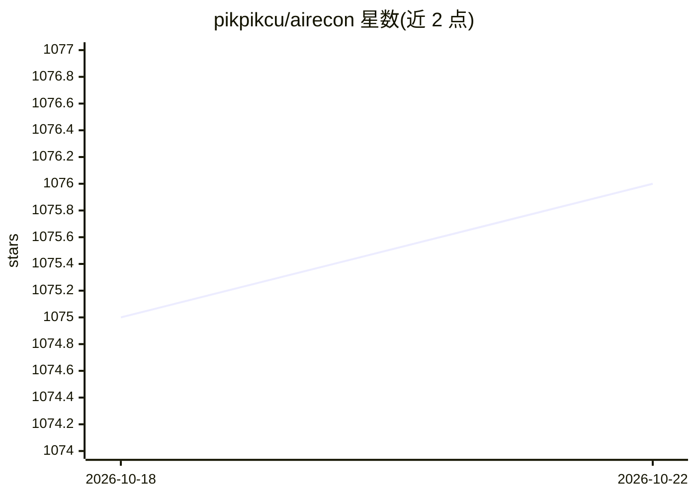

# pikpikcu/airecon

⭐ 1,078 · Python · MIT · 推送 2026-10-12 · [GitHub](https://github.com/pikpikcu/airecon) · 个人维护

**面向渗透测试与Bug Bounty的自主安全agent，本地LLM驱动**

自主渗透测试agent：以单一OpenAI兼容LLM网关为后端（可指向本地LiteLLM/vLLM或代理本地Ollama，实现无API key全离线运行），在Kali Linux Docker沙箱中执行RECON→ANALYSIS→EXPLOIT→REPORT流水线，配备Textual TUI、Caido代理集成、浏览器自动化、fuzzer与Semgrep SAST。学习机制为本地SQLite遥测（仅持久化已验证发现），不做微调；可选airecon-dataset将约109万条安全记录索引进本地SQLite FTS5供LLM查询。要求模型支持原生function calling；提供Colab T4运行Ollama的方案应对本地无GPU场景。

## 筛选速览

| 维度 | 判定 | 备注 |
|---|---|---|
| AI 角色 | `ai-native` | 本体是模型或模型工具 |
| 许可风险 | `permissive` | MIT |
| 部署形态 | `self-host` | docker 或自建部署 |
| 模型依赖 | local-ok | 支持本地模型 |
| 硬件要求 | — | 无带数字的原话,不猜 |
| 安装摩擦 | `low` | 无编译、无系统依赖或容器化 |
| 成熟度 | — | 结构信号不足 |

## 能力要点

- RECON→ANALYSIS→EXPLOIT→REPORT结构化流水线，阶段软约束+定期检查点
- 本地网关（Ollama/vLLM经LiteLLM代理）实现全离线、无API key运行
- 仅持久化已验证发现的本地记忆机制，不微调模型
- 可选本地知识库：约109万条安全记录索引进SQLite FTS5，LLM经dataset_search自主查询

## 适用场景

- 授权范围内自动化渗透测试与侦察
- Bug Bounty目标的信息收集与漏洞分析
- 本地离线运行安全agent，避免目标数据外泄

## 场景标签

`网络安全` `浏览器自动化` · 领域:效率与自动化

## 证据(README 行号)

> L3:  AI-Powered Autonomous Penetration Testing Agent
> L13: AIRecon is an autonomous penetration testing agent that drives any **OpenAI-compatible LLM gateway** (LiteLLM / vLL
> L51: RECON → ANALYSIS → EXPLOIT → REPORT

## 星数曲线

2026-10-18 1,075 → 2026-10-22 1,076（+1）

---
*卡片 v1 · prompt 1.4 · 生成 2026-10-21 · 置信度 mid · 依据 README sha `6e2a049bec89` · [字段定义](../../DATASET.md)*
