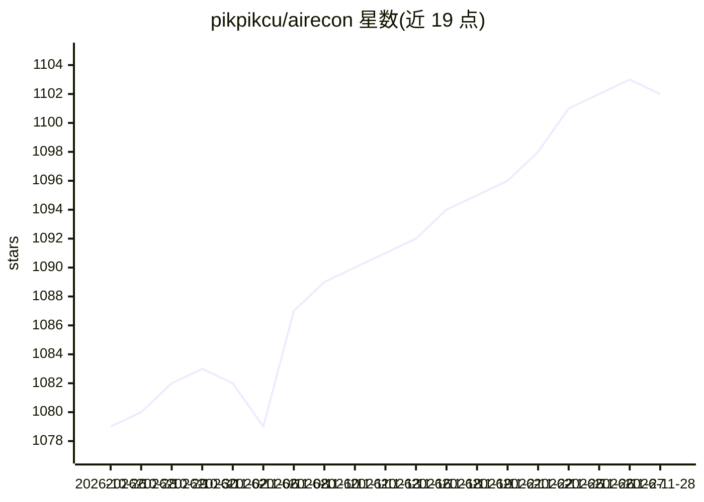

# pikpikcu/airecon

⭐ 1,102 · Python · MIT · 推送 2026-11-12 · [GitHub](https://github.com/pikpikcu/airecon) · 个人维护

**自主渗透测试 agent：本地 LLM+Kali 沙箱跑侦察与利用**

自主渗透测试 agent，通过任意 OpenAI 兼容网关（LiteLLM/vLLM/托管端点或代理本地 Ollama）驱动 LLM，在 Kali Linux Docker 沙箱中执行安全评估、渗透测试与 bug bounty 侦察。采用 RECON→ANALYSIS→EXPLOIT→REPORT 软约束流水线，配 Textual TUI 与原生 Caido 集成。学习机制为本地 SQLite 遥测而非模型微调，仅持久化已验证发现；可选 airecon-dataset 将约 109 万安全记录索引进本地 SQLite FTS5 供 agent 检索。要求后端模型支持原生工具调用。

## 筛选速览

| 维度 | 判定 | 备注 |
|---|---|---|
| AI 角色 | `ai-native` | 本体是模型或模型工具 |
| 许可风险 | `permissive` | MIT |
| 部署形态 | `self-host` | docker 或自建部署 |
| 模型依赖 | local-ok | 支持本地模型 |
| 硬件要求 | — | 无带数字的原话,不猜 |
| 安装摩擦 | `low` | 无编译、无系统依赖或容器化 |
| 成熟度 | — | 结构信号不足 |

## 能力要点

- OpenAI 兼容网关后端无关设计，本地网关下完全离线、无 API key
- RECON→ANALYSIS→EXPLOIT→REPORT 流水线，带 scope guard 与审计日志
- 本地 SQLite 记忆与 verified-only 跨会话学习
- 可选本地知识库约 109 万条安全记录（CVE/红队/CTF/nuclei）

## 适用场景

- 在没有云依赖的本地环境跑自动化侦察
- bug bounty 项目的前期信息收集与漏洞验证
- 配合 Caido 代理做请求重放与模糊测试
- CTF 场景下调用社区技能库 playbook

## 场景标签

`网络安全` · 领域:学习与行业

## 证据(README 行号)

> L13: AIRecon is an autonomous penetration testing agent that drives any **OpenAI-compatible LLM gateway** (LiteLLM / vLL
> L51: RECON → ANALYSIS → EXPLOIT → REPORT
> L46: - **Local Security Knowledge Base** — Optional **airecon-dataset** indexes ~1.09M security records (CVEs, red team 

## 星数曲线

2026-10-26 1,079 → 2026-11-28 1,102（+23）

---
*卡片 v1 · prompt 1.4 · 生成 2026-11-24 · 置信度 high · 依据 README sha `ea03c4315720` · [字段定义](../../DATASET.md)*
