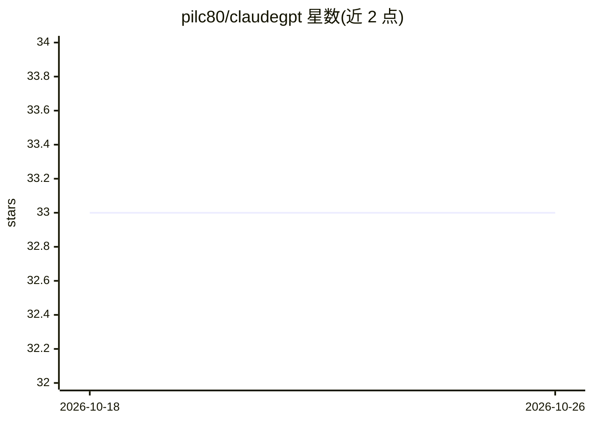

# pilc80/claudegpt

⭐ 33 · Rust · MIT · 推送 2026-08-01 · [GitHub](https://github.com/pilc80/claudegpt) · 个人维护

**让 Claude Code 通过 OAuth 使用 ChatGPT/Codex 订阅的代理**

claudex 的一个 fork（基于上游 v0.2.4），作为 Claude Code 到 OpenAI Responses 的本地代理：将 Anthropic Messages 协议转换为 ChatGPT/Codex Responses 端点请求，让用户以 ChatGPT Plus/Pro 或 Codex 订阅 OAuth 登录，无需 OpenAI API key。保留 Claude Code 工作流：图片/文件块、工具调用、/compact 与上下文恢复、prompt-cache 用量映射、错误语义转换；WebSearch 不支持时自动禁用并改用 WebFetch。安装方式含发布版安装脚本（macOS/Linux/Windows PowerShell）与 cargo 源码安装。Rust 实现，非 Responses 提供商沿用上游行为。

## 筛选速览

| 维度 | 判定 | 备注 |
|---|---|---|
| AI 角色 | `ai-ecosystem` | LLM/agent 周边工具 |
| 许可风险 | `permissive` | MIT |
| 部署形态 | `desktop` | 安装包/桌面程序 |
| 模型依赖 | — | README 未给出锁定关系 |
| 硬件要求 | — | 无带数字的原话,不猜 |
| 安装摩擦 | `medium` | 含编译或系统依赖之一 |
| 成熟度 | — | 结构信号不足 |

## 能力要点

- Anthropic Messages 协议到 OpenAI Responses 的转换与 OAuth 接入
- 保留 /compact、自动压缩、上下文超限恢复流程
- prompt-cache 键与 cached-token 用量映射回 Claude Code
- 安装器带 SHA256 校验、版本检查与 claudex-config config doctor 健康检查

## 适用场景

- 用 ChatGPT/Codex 订阅替代 API key 运行 Claude Code
- 在 Claude Code 中使用 GPT 模型并保留图片、文件、工具调用工作流
- 本地部署代理并通过 claudex-config 管理多个 OAuth 配置

## 场景标签

`模型网关` · 领域:Agent 开发

## 证据(README 行号)

> L6: Claudex is a high-fidelity Claude Code -> OpenAI Responses proxy for
> L79: ```text
> L82:   -> claudex OpenAIResponses adapter

## 星数曲线



2026-10-18 33 → 2026-10-26 33（+0）


---
*卡片 v1 · prompt 1.4 · 生成 2026-10-25 · 置信度 high · 依据 README sha `fbe2d32ab7e1` · [字段定义](../../DATASET.md)*
