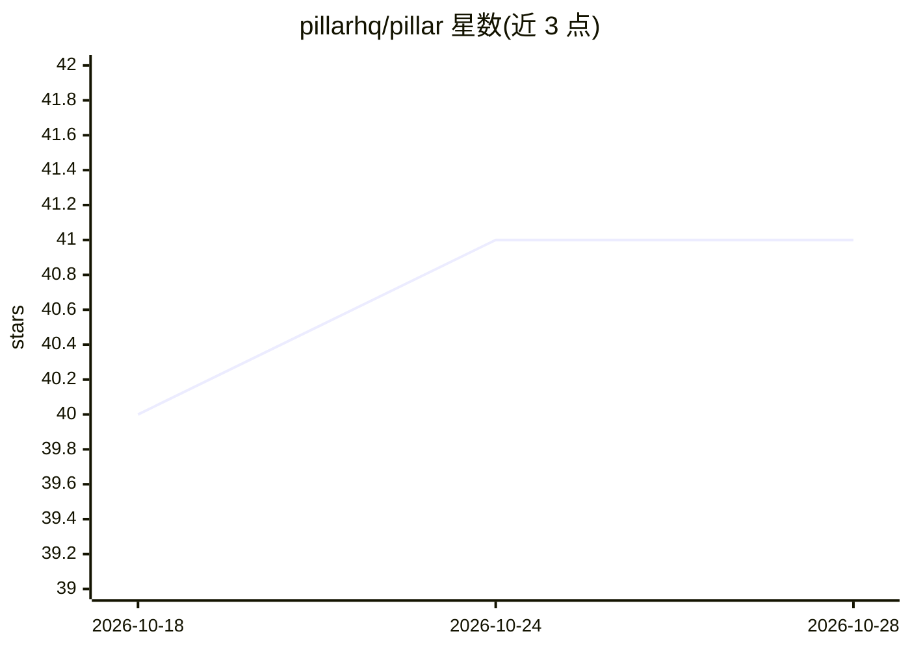

# pillarhq/pillar

⭐ 41 · Python · AGPL-3.0 · 推送 2026-04-14 · [GitHub](https://github.com/pillarhq/pillar) · [官网](https://trypillar.com) · 组织维护

**面向 SaaS 的开源 AI 副驾平台：在应用中嵌入可执行操作的智能体**

Pillar 是可嵌入的开源 AI copilot 平台，包含 Django 后端 API（RAG 管线、MCP 服务器、Hatchet 工作流）与 Next.js 管理面板；SDK（React/Vue/Angular/JS，独立仓库）通过 usePillarTool 注册工具，使助手在用户浏览器端以用户会话导航页面、预填表单、调用 API，无需代理服务器。知识库可从网站、文件、S3/GCS 等来源摄取并自动更新。自托管走 Docker Compose，需至少一个 AI 供应商 API key 与 Hatchet 实例；平台 AGPL-3.0，另提供商业许可，SDK 为 MIT。

## 筛选速览

| 维度 | 判定 | 备注 |
|---|---|---|
| AI 角色 | `ai-ecosystem` | LLM/agent 周边工具 |
| 许可风险 | `dual` | AGPL-3.0 |
| 部署形态 | `self-host` | docker 或自建部署 |
| 模型依赖 | — | README 未给出锁定关系 |
| 硬件要求 | — | 无带数字的原话,不猜 |
| 安装摩擦 | `low` | 无编译、无系统依赖或容器化 |
| 成熟度 | — | 结构信号不足 |

## 能力要点

- 客户端执行：以用户会话在浏览器内导航、填表、调 API，无代理与 token 转发
- 内置标准 MCP 与 WebMCP 服务器
- 知识库摄取网站/文件/S3/GCS/片段并自动保持更新（RAG）
- React/Vue/Angular/Vanilla JS 多框架 SDK（MIT）

## 适用场景

- 在我的 SaaS 应用里加一个能替用户执行操作的 AI 助手
- 让客户通过对话完成下单、建任务等应用内流程
- 自托管一套带知识库与 RAG 的产品客服副驾

## 场景标签

`AI 助手` `聊天机器人` `RAG` · 领域:对话与助手

## 证据(README 行号)

> L19: **The open-source product copilot. Build AI agents into your app that execute tasks, not just answer questions.**
> L23: Pillar is an embeddable AI co-pilot SDK. Users say what they want, and Pillar uses your UI to make it happen — navi
> L37: *This repository contains the Pillar platform: backend API and admin dashboard. SDK packages are maintained separat

## 星数曲线

2026-10-18 40 → 2026-10-28 41（+1）

---
*卡片 v1 · prompt 1.4 · 生成 2026-10-25 · 置信度 high · 依据 README sha `cffbaa159c08` · [字段定义](../../DATASET.md)*
