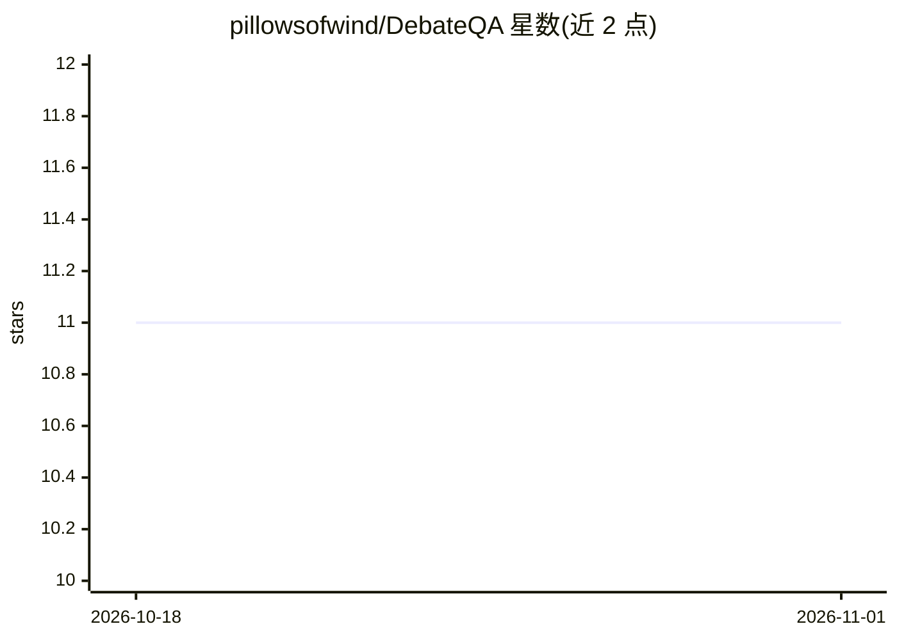

# pillowsofwind/DebateQA

⭐ 11 · Python · 推送 2026-01-16 · [GitHub](https://github.com/pillowsofwind/DebateQA) · [官网](http://arxiv.org/pdf/2408.01419) · 组织维护

**评测有争议知识问答的数据集与两项指标（EACL 2026 论文）**

EACL 2026 论文 "DebateQA: Evaluating Question Answering on Debatable Knowledge" 的官方仓库，提供 2,941 个人工标注的有争议问题数据集（test 1,000 / dev 1,941），每题配多个代表不同立场的部分答案。同时提供两项评测指标：基于 PPL 的 Perspective Diversity（衡量答案视角覆盖度）与基于提示的二分类 Dispute Awareness（检测模型是否承认问题存在争议）。评测脚本通过 bash 运行，输入为 jsonl 格式的模型回答，评测器模型默认为 Phi3/GPT-2 或 MiniCPM。

## 筛选速览

| 维度 | 判定 | 备注 |
|---|---|---|
| AI 角色 | `ai-knowledge` | 知识聚合/清单类 |
| 许可风险 | `none` | — |
| 部署形态 | `library` | 以包/库形式分发 |
| 模型依赖 | — | README 未给出锁定关系 |
| 硬件要求 | — | 无带数字的原话,不猜 |
| 安装摩擦 | `medium` | 含编译或系统依赖之一 |
| 成熟度 | — | 结构信号不足 |

## 能力要点

- 2,941 个人工标注的有争议问题及多视角部分答案
- Perspective Diversity：基于 PPL 的视角覆盖度量化指标
- Dispute Awareness：提示式二分类争议识别指标
- 对 12 个 LLM 的实验结果与排行

## 适用场景

- 评测我的模型回答有争议问题时的视角全面性
- 检测模型是否把有争议问题当作确定事实回答
- 获取带人工标注多视角答案的争议问题基准数据集

## 场景标签

`模型评测` · 领域:评测与运维

## 证据(README 行号)

> L3: This repo consists of the dataset and evaluation scripts for the EACL 2026 paper **"DebateQA: Evaluating Question An
> L12: In our work, we present **the DebateQA dataset** tailored for evaluating debatable questions, which includes a coll
> L19: Our dataset, DebateQA, comprises 2,941 debatable questions, each paired with multiple partial answers annotated by 

## 星数曲线

2026-10-18 11 → 2026-11-01 11（+0）

---
*卡片 v1 · prompt 1.4 · 生成 2026-11-01 · 置信度 high · 依据 README sha `104ee8b0b81f` · [字段定义](../../DATASET.md)*
