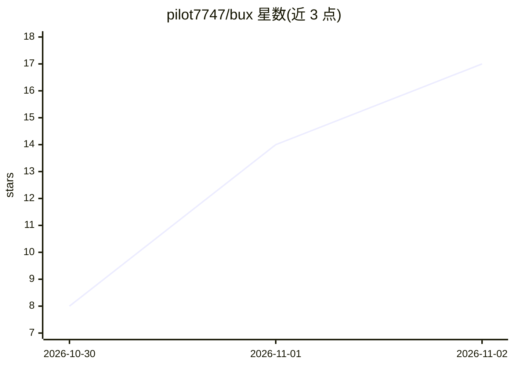

# pilot7747/bux

⭐ 17 · Python · Apache-2.0 · 推送 2026-11-01 · [GitHub](https://github.com/pilot7747/bux) · [官网](https://bux.readthedocs.io) · 个人维护

**JAX 语言模型预训练消融框架：几行配置跑架构/数据对比实验**

基于 JAX/Flax NNX 的语言模型训练框架，面向预训练消融研究。模型以残差流代数表达式写在 .bux 文件中，模型、数据、优化器、调度、精度与并行策略同处一文件，用 | 将任意设置展开为 sweep；运行前对每项设置做类型与交叉检查。支持从笔记本 CPU 到多节点 GPU 集群训练，提供 FSDP/张量/专家/流水线并行、超参搜索、62 个可按名引用的架构、导出到 transformers 并可由 vLLM 插件服务。安装需 Python 3.14+ 与 uv，另提供 Docker 镜像。

## 筛选速览

| 维度 | 判定 | 备注 |
|---|---|---|
| AI 角色 | `ai-ecosystem` | LLM/agent 周边工具 |
| 许可风险 | `permissive` | Apache-2.0 |
| 部署形态 | `self-host` | docker 或自建部署 |
| 模型依赖 | local-ok | 支持本地模型 |
| 硬件要求 | — | 无带数字的原话,不猜 |
| 安装摩擦 | `low` | 无编译、无系统依赖或容器化 |
| 成熟度 | — | 结构信号不足 |

## 能力要点

- 模型即表达式：`[norm attn] [norm ffn]`、`block^32` 一行描述架构，`|` 可 sweep 任意设置
- 运行前逐行类型/交叉检查，GPU 启动前报错
- FSDP/张量/专家/上下文/流水线并行，单 GPU 到八节点
- 62 个转录架构的模型库，训练结果导出 transformers 并经 vLLM 插件服务

## 适用场景

- 快速跑架构或数据配方的预训练消融实验
- 在同一文件内对优化器、学习率等做 sweep 与超参搜索
- 从模型库出发复现或改造 GPT-2 到 2026 年发布的各类架构

## 场景标签

`模型训练` · 领域:训练与推理

## 证据(README 行号)

> L21: bux is a JAX framework for comparing language models. You write a model as an algebra
> L24: runs, then trains with Flax NNX on anything from a laptop CPU to multi-node GPU

## 星数曲线

2026-10-30 8 → 2026-11-02 17（+9）

---
*卡片 v1 · prompt 1.4 · 生成 2026-10-31 · 置信度 high · 依据 README sha `4c50511e6a95` · [字段定义](../../DATASET.md)*
