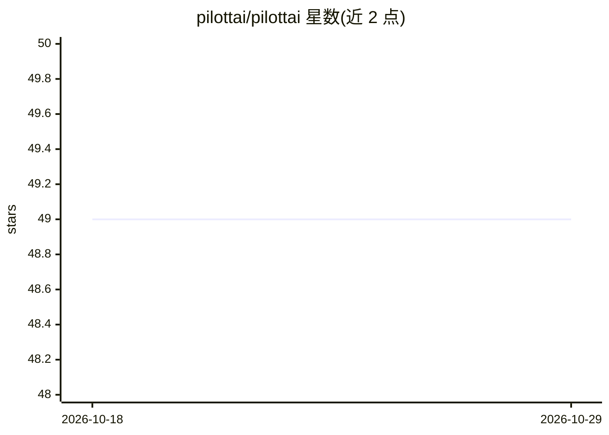

# pilottai/pilottai

⭐ 49 · Python · MIT · 推送 2026-02-20 · [GitHub](https://github.com/pilottai/pilottai) · [官网](https://pilottai.com) · 组织维护

**构建自主多智能体系统的 Python 框架**

以 pip 包提供的 Python 多智能体框架：支持管理者/工作者层级智能体体系、智能任务路由与上下文感知处理；内置异步处理、动态扩展、负载均衡与容错等生产特性；提供语义存储与任务历史追踪的记忆模块。集成方面支持 OpenAI、Anthropic、Google 等多家 LLM 提供商及文档处理、WebSocket、自定义工具。附带客服、文档处理、邮件、营销等即用型专用智能体。要求 Python 3.10+，MIT 许可。

## 筛选速览

| 维度 | 判定 | 备注 |
|---|---|---|
| AI 角色 | `ai-ecosystem` | LLM/agent 周边工具 |
| 许可风险 | `permissive` | MIT |
| 部署形态 | `library` | 以包/库形式分发 |
| 模型依赖 | — | README 未给出锁定关系 |
| 硬件要求 | — | 无带数字的原话,不猜 |
| 安装摩擦 | `low` | 无编译、无系统依赖或容器化 |
| 成熟度 | — | 结构信号不足 |

## 能力要点

- 管理者/工作者层级智能体体系与智能任务路由
- 异步处理、动态扩展、负载均衡与容错
- 语义存储、任务历史追踪与知识检索记忆模块
- 集成 OpenAI/Anthropic/Google 等多家 LLM 提供商

## 适用场景

- 用 Python 构建可扩展的多智能体应用
- 搭建客服、邮件、营销等专用智能体流程
- 需要任务编排与容错的智能体生产部署

## 场景标签

`Agent 框架` `多智能体` · 领域:Agent 开发

## 证据(README 行号)

> L22: PilottAI is a Python framework for building autonomous multi-agent systems with advanced orchestration capabilities
> L46:  - Multiple LLM providers (OpenAI, Anthropic, Google)

## 星数曲线

2026-10-18 49 → 2026-10-29 49（+0）

---
*卡片 v1 · prompt 1.4 · 生成 2026-10-24 · 置信度 high · 依据 README sha `ad176bec7da9` · [字段定义](../../DATASET.md)*
