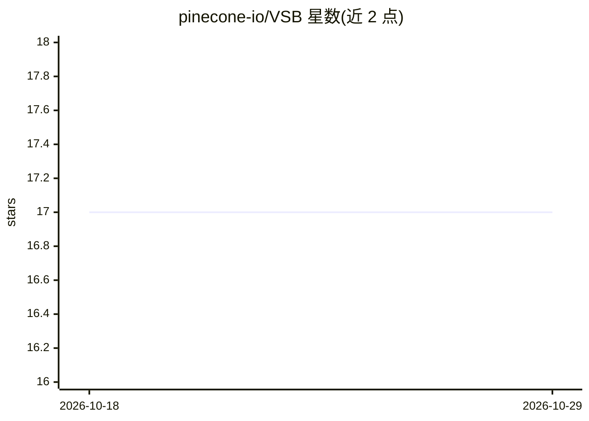

# pinecone-io/VSB

⭐ 17 · Python · MIT · 推送 2026-08-14 · [GitHub](https://github.com/pinecone-io/VSB) · 组织维护

**向量数据库性能基准测试 CLI：多负载测吞吐/延迟/召回**

Pinecone 维护的向量检索基准测试套件，以 CLI 工具形式对向量数据库执行 Setup/Populate/Run 三阶段实验，测量吞吐、延迟（含百分点统计与实时值）与召回等指标，结果写入 stats.json。当前支持 Pinecone、pgvector、OpenSearch 三种数据库，本地数据库通过 Docker Compose 启动。内置 6 种负载（mnist/nq768/yfcc-10M/cohere768/msmarco-v2-ada/synthetic），并提供三种合成负载模式与元数据生成规格。需 Python>=3.11 与 Poetry 安装。

## 筛选速览

| 维度 | 判定 | 备注 |
|---|---|---|
| AI 角色 | `ai-ecosystem` | LLM/agent 周边工具 |
| 许可风险 | `permissive` | MIT |
| 部署形态 | `self-host` | docker 或自建部署 |
| 模型依赖 | — | README 未给出锁定关系 |
| 硬件要求 | — | 无带数字的原话,不猜 |
| 安装摩擦 | `low` | 无编译、无系统依赖或容器化 |
| 成熟度 | — | 结构信号不足 |

## 能力要点

- Setup/Populate/Run 三阶段自动执行并输出 stats.json
- 支持 Pinecone、pgvector、OpenSearch 三种向量数据库
- 内置 6 种负载，最大 1.38 亿条记录（msmarco-v2-ada）
- 三种合成负载模式，支持自定义记录数/维度/操作比例/元数据 schema

## 适用场景

- 对比多个向量数据库的吞吐、延迟与召回表现
- 用合成负载模拟生产访问模式做容量规划
- 对数据库变更做性能回归测试

## 场景标签

`模型评测` · 领域:评测与运维

## 证据(README 行号)

> L83: VSB is a CLI tool that runs various workloads against a range of
> L99: The following databases are currently supported by VSB:

## 星数曲线

2026-10-18 17 → 2026-10-29 17（+0）

---
*卡片 v1 · prompt 1.4 · 生成 2026-10-29 · 置信度 mid · 依据 README sha `ddfa12c39602` · [字段定义](../../DATASET.md)*
