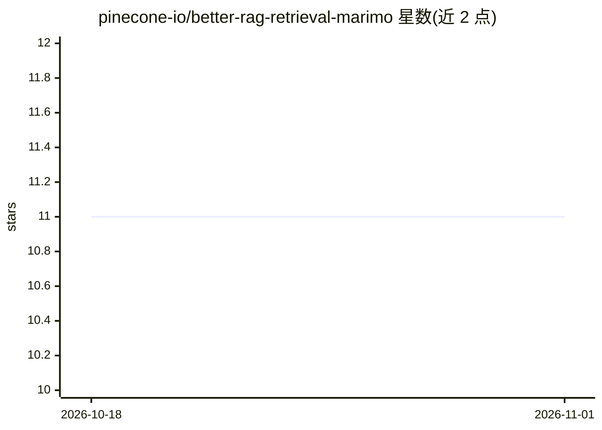

# pinecone-io/better-rag-retrieval-marimo

⭐ 11 · Python · MIT · 推送 2026-10-31 · [GitHub](https://github.com/pinecone-io/better-rag-retrieval-marimo) · 组织维护

**讲授 RAG 检索方法选型的 Pinecone 教学 notebook**

由 Pinecone 维护的讲座演示仓库：基于约 2,000 篇北美鸟类维基文章（文本+照片），以 Marimo notebook 形式讲授关键词（BM25）、稠密语义、视觉跨模态三种检索原语及混合过滤、粗到精、Agentic 路由三种组合方式，每种技术配真实 Pinecone 调用，并用人工构建的评测集打分。需要 Pinecone、Gemini、Anthropic 三个 API key；首次运行自动构建两个索引，图像嵌入约需 15–30 分钟（磁盘缓存）。面向学习 RAG 检索选型的开发者与授课者。

## 筛选速览

| 维度 | 判定 | 备注 |
|---|---|---|
| AI 角色 | `ai-knowledge` | 知识聚合/清单类 |
| 许可风险 | `permissive` | MIT |
| 部署形态 | `None` |  |
| 模型依赖 | locked-api |  |
| 硬件要求 | — | 无带数字的原话,不猜 |
| 安装摩擦 | `low` | 无编译、无系统依赖或容器化 |
| 成熟度 | — | 结构信号不足 |

## 能力要点

- 三种检索原语 + 三种组合方式，每种展示真实 Pinecone 调用并按评测集打分
- 双索引架构：全文+图像嵌入索引与文本稠密索引分开，规避单索引一个稠密向量字段的限制
- Gemini Embedding 2 多模态嵌入，文本查询可直接与照片嵌入比对（768 维余弦相似度）
- 结尾提供全技术×全问题的记分板与交互式查询构建器

## 适用场景

- 学习不同 RAG 检索技术在什么场景下更合适
- 课堂上演示混合检索与跨模态检索的实际效果
- 作为 Pinecone 全文搜索与多模态嵌入的参考实现

## 场景标签

`RAG` `教程课程` · 领域:知识与检索

## 证据(README 行号)

> L1: # Bird Search — a Pinecone teaching demo 🐦
> L3: A lecture demo on **improving RAG retrieval** with Pinecone, over a corpus of
> L5: deliverable is a **Marimo notebook** that teaches *when to reach for which

## 星数曲线

2026-10-18 11 → 2026-11-01 11（+0）

---
*卡片 v1 · prompt 1.4 · 生成 2026-11-01 · 置信度 high · 依据 README sha `92ea4bfd7cdb` · [字段定义](../../DATASET.md)*
