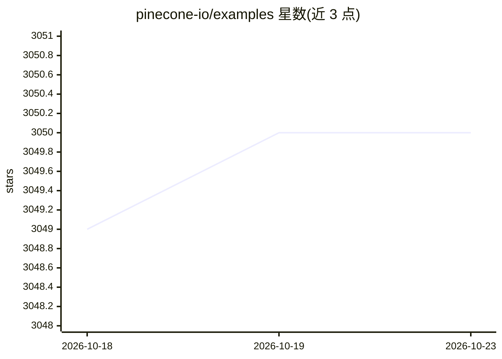

# pinecone-io/examples

⭐ 3,050 · Jupyter Notebook · MIT · 推送 2026-10-20 · [GitHub](https://github.com/pinecone-io/examples) · [官网](https://docs.pinecone.io) · 组织维护

**Pinecone 向量数据库的示例应用与 Jupyter Notebook 合集**

Pinecone 官方维护的示例仓库，分两类内容：./docs 下由 Pinecone 工程团队定期评审与支持的生产级示例，以及 ./learn 下由开发者布道团队创建、面向学习探索 AI 技术与应用构建模式的教学示例。主题覆盖向量数据库、RAG、语义搜索等常见 AI 模式，可在 Google Colab 中设置并运行 Jupyter Notebook。面向使用 Pinecone 的开发者和学习者。

## 筛选速览

| 维度 | 判定 | 备注 |
|---|---|---|
| AI 角色 | `ai-knowledge` | 知识聚合/清单类 |
| 许可风险 | `permissive` | MIT |
| 部署形态 | `None` |  |
| 模型依赖 | — | README 未给出锁定关系 |
| 硬件要求 | — | 无带数字的原话,不猜 |
| 安装摩擦 | `low` | 无编译、无系统依赖或容器化 |
| 成熟度 | — | 结构信号不足 |

## 能力要点

- 生产级示例由 Pinecone 工程团队定期评审与支持
- ./learn 部分提供 AI 技术学习与应用构建模式示例
- 支持在 Google Colab 中运行 Jupyter Notebook

## 适用场景

- 动手学习 Pinecone 向量数据库的常用模式
- 参考 RAG、语义搜索等 AI 应用的示例代码
- 基于示例修改构建自己的向量检索应用

## 场景标签

`RAG` `语义搜索` `教程课程` · 领域:知识与检索

## 证据(README 行号)

> L5: This repository is a collection of sample applications and Jupyter Notebooks that you can run, download, study and m
> L6: Pinecone vector databases and common AI patterns, tools and algorithms.
> L12: 1. Production ready examples in `./docs` that receive regular review and support from the Pinecone engineering team
> L13: 2. Examples optimized for learning and exploration of AI techniques in `./learn` and patterns for building differen

## 星数曲线

2026-10-18 3,049 → 2026-10-23 3,050（+1）

---
*卡片 v1 · prompt 1.4 · 生成 2026-10-20 · 置信度 high · 依据 README sha `d49b553dca26` · [字段定义](../../DATASET.md)*
