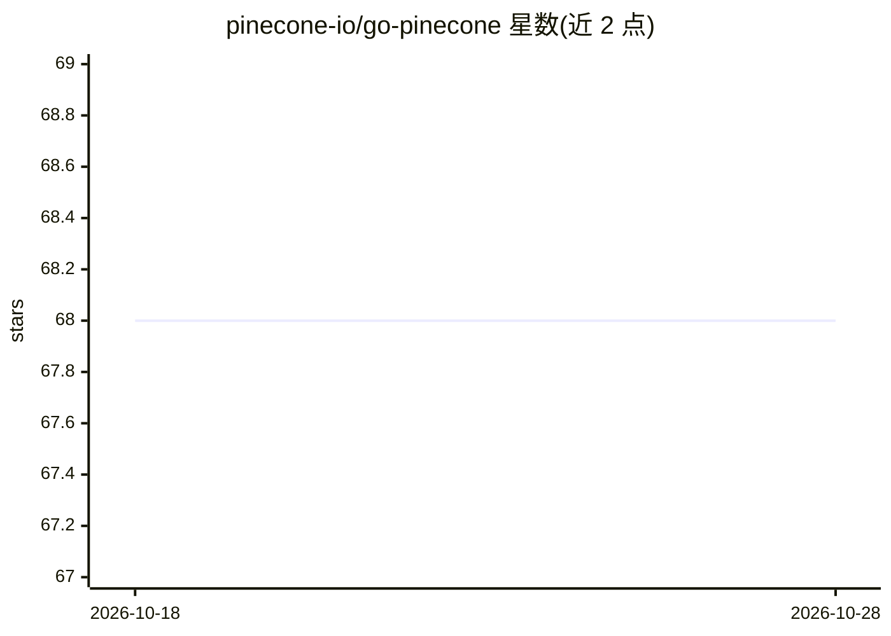

# pinecone-io/go-pinecone

⭐ 68 · Go · Apache-2.0 · 推送 2026-10-20 · [GitHub](https://github.com/pinecone-io/go-pinecone) · [官网](https://pkg.go.dev/github.com/pinecone-io/go-pinecone/v5/pinecone) · 组织维护

**Pinecone 向量数据库的官方 Go 客户端 SDK**

Pinecone 官方维护的 Go SDK，覆盖 Pinecone API 2026-07 版本的控制面、数据面、Inference 与 Admin 接口：支持文档全文检索与向量检索、Pinecone 托管模型的集成嵌入（无需自行管理向量）、向量记录的 gRPC 增删改查、索引/备份/集合/命名空间管理、嵌入生成与重排序，以及指数退避的可选自动重试。面向在 Go 项目中接入 Pinecone 数据库的开发者，需 Go 1.25+ 与 Pinecone API key。v7 移除了创建 pod 型索引的能力。

## 筛选速览

| 维度 | 判定 | 备注 |
|---|---|---|
| AI 角色 | `ai-ecosystem` | LLM/agent 周边工具 |
| 许可风险 | `permissive` | Apache-2.0 |
| 部署形态 | `None` |  |
| 模型依赖 | — | README 未给出锁定关系 |
| 硬件要求 | — | 无带数字的原话,不猜 |
| 安装摩擦 | `low` | 无编译、无系统依赖或容器化 |
| 成熟度 | — | 结构信号不足 |

## 能力要点

- Documents API：文档 schema 上的全文检索、查询字符串与向量检索
- 集成嵌入：由 Pinecone 托管模型嵌入文本，无需自行管理向量
- Vectors API 经 gRPC 进行记录 upsert/query/fetch/update/delete/list
- Inference API 生成嵌入与重排序，Admin API 管理项目/组织/API key 等

## 适用场景

- 在 Go 服务中读写 Pinecone 向量索引做相似度检索
- 通过 SDK 管理索引、备份、集合与命名空间
- 使用 Pinecone 托管模型实现免管理向量的语义搜索

## 场景标签

`向量数据库` · 领域:知识与检索

## 证据(README 行号)

> L3: The Pinecone Go SDK is the official Go client for Pinecone Database.
> L17: The SDK targets Pinecone API version `2026-07`, covering the control plane, data plane, Inference, and Admin APIs. 

## 星数曲线

2026-10-18 68 → 2026-10-28 68（+0）

---
*卡片 v1 · prompt 1.4 · 生成 2026-10-24 · 置信度 high · 依据 README sha `5e7d7b3197c0` · [字段定义](../../DATASET.md)*
