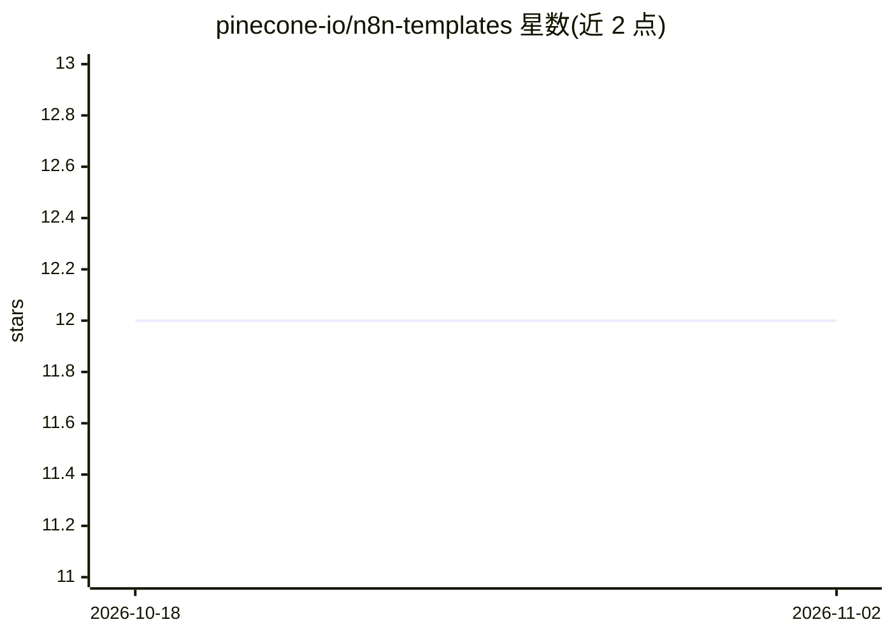

# pinecone-io/n8n-templates

⭐ 12 · MIT · 推送 2026-08-14 · [GitHub](https://github.com/pinecone-io/n8n-templates) · 组织维护

**Pinecone 官方的 n8n 工作流模板集：即用 RAG 自动化**

由 Pinecone 维护的 n8n 工作流模板集合，围绕 Pinecone Assistant 与向量数据库构建智能自动化流程。覆盖与 Google Drive/Dropbox 文档对话、LinkedIn 评论洞察提取、Slack 支持文档问答、度假租赁多助手管理等场景，集成 OpenAI、Google Drive、Apify 等服务。使用方式为将 JSON 模板粘贴或从文件/URL 导入 n8n，再添加相应凭证即可运行。MIT-0 许可，无安装包，需自行运行 n8n 与持有 Pinecone 等服务凭证。

## 筛选速览

| 维度 | 判定 | 备注 |
|---|---|---|
| AI 角色 | `ai-knowledge` | 知识聚合/清单类 |
| 许可风险 | `permissive` | MIT |
| 部署形态 | `None` |  |
| 模型依赖 | — | README 未给出锁定关系 |
| 硬件要求 | — | 无带数字的原话,不猜 |
| 安装摩擦 | `low` | 无编译、无系统依赖或容器化 |
| 成熟度 | — | 结构信号不足 |

## 能力要点

- 提供 8 个即用 n8n 工作流 JSON 模板
- 模板基于 Pinecone Assistant 与 Pinecone Vector Database 两种路径
- 支持粘贴 JSON、文件导入、URL 导入三种导入方式

## 适用场景

- 快速搭建与 Google Drive/Dropbox 文档对话的 RAG 工作流
- 通过 Slack 接入支持文档问答机器人
- 参考模板学习 n8n 与 Pinecone 的集成方式

## 场景标签

`工作流自动化` `RAG` `文档问答` · 领域:效率与自动化

## 证据(README 行号)

> L3: A collection of ready-to-use n8n workflow templates for building intelligent automations using Pinecone.
> L36: |Template|File|Integrations used|

## 星数曲线

2026-10-18 12 → 2026-11-02 12（+0）

---
*卡片 v1 · prompt 1.4 · 生成 2026-11-01 · 置信度 mid · 依据 README sha `e9b15f5f4f54` · [字段定义](../../DATASET.md)*
