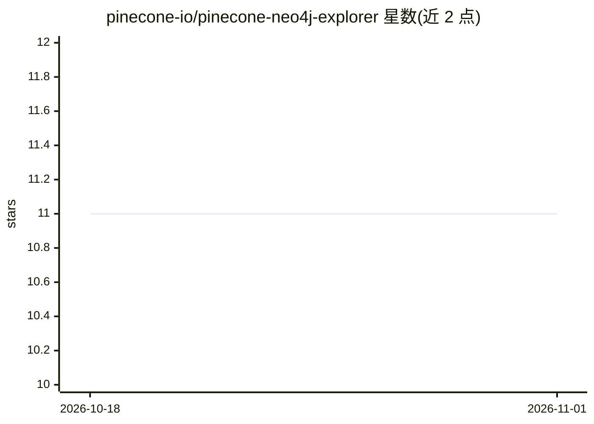

# pinecone-io/pinecone-neo4j-explorer

⭐ 11 · TypeScript · Apache-2.0 · 推送 2026-10-26 · [GitHub](https://github.com/pinecone-io/pinecone-neo4j-explorer) · 组织维护

**Pinecone+Neo4j 集成示例：分析探索最高法院案例**

演示项目，将 Pinecone 向量数据库与 Neo4j 图数据库集成，处理并探索美国最高法院案例。组件包括 MongoDB、Neo4j 与 Pinecone；通过 Poetry 安装 Python 依赖、pnpm 安装前端依赖，配置各服务凭据与 OpenAI API key；数据流程由 Jupyter notebook 完成（抓取原始案例、处理 SCOTUS 案例并生成嵌入），随后在 explorer 目录以 pnpm dev 启动应用。

## 筛选速览

| 维度 | 判定 | 备注 |
|---|---|---|
| AI 角色 | `ai-ecosystem` | LLM/agent 周边工具 |
| 许可风险 | `permissive` | Apache-2.0 |
| 部署形态 | `library` | 以包/库形式分发 |
| 模型依赖 | — | README 未给出锁定关系 |
| 硬件要求 | — | 无带数字的原话,不猜 |
| 安装摩擦 | `low` | 无编译、无系统依赖或容器化 |
| 成熟度 | — | 结构信号不足 |

## 能力要点

- Pinecone 与 Neo4j 集成，面向最高法院案例分析
- process_scotus.ipynb 处理案例并生成嵌入
- Python（Poetry）+ Node.js（pnpm）双端依赖的示例工程

## 适用场景

- 参考如何在 RAG 管线中同时使用向量库与图数据库
- 了解 Pinecone 集成 Neo4j 的数据流与配置方式

## 场景标签

`RAG` `知识图谱` · 领域:知识与检索

## 证据(README 行号)

> L3: ### Supreme Court Case Analysis
> L32:  - PINECONE_API_KEY

## 星数曲线

2026-10-18 11 → 2026-11-01 11（+0）

---
*卡片 v1 · prompt 1.4 · 生成 2026-11-01 · 置信度 low · 依据 README sha `b1f3b9abcf00` · [字段定义](../../DATASET.md)*
