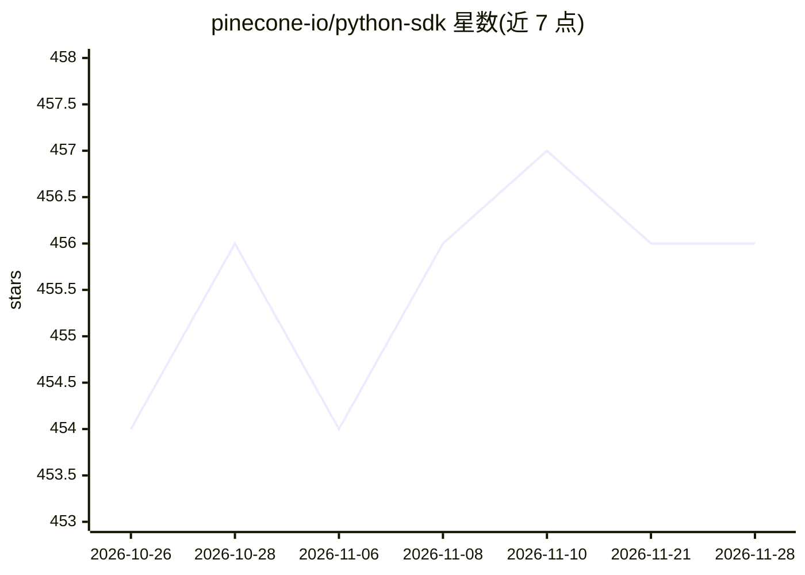

# pinecone-io/python-sdk

⭐ 456 · Python · Apache-2.0 · 推送 2026-11-03 · [GitHub](https://github.com/pinecone-io/python-sdk) · [官网](https://pinecone-io.github.io/python-sdk/) · 组织维护

**Pinecone 向量数据库官方 Python 客户端 SDK**

面向 Python 开发者连接 Pinecone 向量数据库的官方客户端库，支持创建与管理索引、文档写入与查询、推理操作，并提供基于 asyncio 的异步客户端。要求 Python 3.10+，通过 pip 安装，凭 API key 连接云端服务。README 给出同步/异步用法示例、超时与日志配置，以及从 9.x 迁移到 v10 的 schema/deployment 字段变更说明。开发部分提供 pytest/mypy/ruff 工作流与需真实后端的集成测试开关。

## 筛选速览

| 维度 | 判定 | 备注 |
|---|---|---|
| AI 角色 | `ai-ecosystem` | LLM/agent 周边工具 |
| 许可风险 | `permissive` | Apache-2.0 |
| 部署形态 | `library` | 以包/库形式分发 |
| 模型依赖 | — | README 未给出锁定关系 |
| 硬件要求 | — | 无带数字的原话,不猜 |
| 安装摩擦 | `low` | 无编译、无系统依赖或容器化 |
| 成熟度 | — | 结构信号不足 |

## 能力要点

- 提供同步与 asyncio 异步两套客户端
- 支持文档索引的 schema 声明与 documents 读写
- 附带 v10 迁移的字段映射说明
- 开发工具链含 pytest、mypy --strict 与 ruff

## 适用场景

- 在 Python 应用中读写和检索 Pinecone 向量索引
- 构建 RAG 流程中的向量存储环节
- 从 Python 调用 Pinecone 推理操作

## 场景标签

`向量数据库` · 领域:知识与检索

## 证据(README 行号)

> L3: The Pinecone Python SDK provides a client for the Pinecone vector database. Use it to create and manage indexes, ups
> L41: The SDK provides an async client for use with `asyncio`. Its `index()` is a

## 星数曲线

2026-10-26 454 → 2026-11-28 456（+2）

---
*卡片 v1 · prompt 1.4 · 生成 2026-11-25 · 置信度 high · 依据 README sha `5bcbcd628f57` · [字段定义](../../DATASET.md)*
