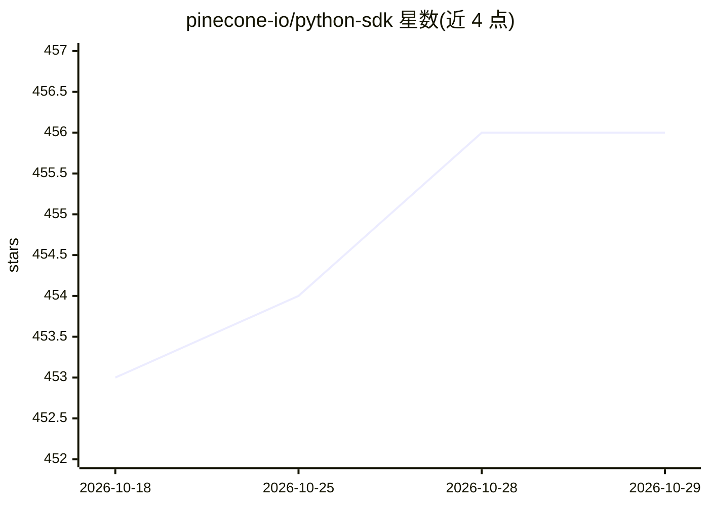

# pinecone-io/python-sdk

⭐ 456 · Python · Apache-2.0 · 推送 2026-10-23 · [GitHub](https://github.com/pinecone-io/python-sdk) · [官网](https://pinecone-io.github.io/python-sdk/) · 组织维护

**Pinecone 向量数据库的官方 Python SDK**

Pinecone 官方 Python 客户端库，用于创建与管理向量索引、upsert 与查询记录及运行推理操作。v10 起 index 以 schema 声明字段，形成文档索引，通过 index.documents 读写 JSON 文档；另有已弃用的顶层向量参数接口与遗留 Records API。提供异步客户端、API key/自定义 host/超时/调试日志等配置。需 Python 3.10+，依赖 Pinecone 托管后端与 API key，Apache-2.0 许可。

## 筛选速览

| 维度 | 判定 | 备注 |
|---|---|---|
| AI 角色 | `ai-ecosystem` | LLM/agent 周边工具 |
| 许可风险 | `permissive` | Apache-2.0 |
| 部署形态 | `library` | 以包/库形式分发 |
| 模型依赖 | — | README 未给出锁定关系 |
| 硬件要求 | — | 无带数字的原话,不猜 |
| 安装摩擦 | `low` | 无编译、无系统依赖或容器化 |
| 成熟度 | — | 结构信号不足 |

## 能力要点

- 创建与管理索引、upsert 与查询记录、运行推理操作
- v10 schema 声明式文档索引与集成 embedding 字段
- 基于 asyncio 的异步客户端
- API key/host/超时/调试日志配置项

## 适用场景

- 在 Python 项目中接入 Pinecone 向量数据库
- 为 RAG 应用写入与检索向量/文档数据
- 异步程序中使用 Pinecone 数据面接口

## 场景标签

`向量数据库` · 领域:知识与检索

## 证据(README 行号)

> L3: The Pinecone Python SDK provides a client for the Pinecone vector database. Use it to create and manage indexes, ups
> L7: Upgrading from 9.x? `create` and `configure` moved from `spec=`/`dimension=` to `schema=`/`deployment=`; see the v10

## 星数曲线

2026-10-18 453 → 2026-10-29 456（+3）

---
*卡片 v1 · prompt 1.4 · 生成 2026-10-21 · 置信度 high · 依据 README sha `45fd2cefee58` · [字段定义](../../DATASET.md)*
