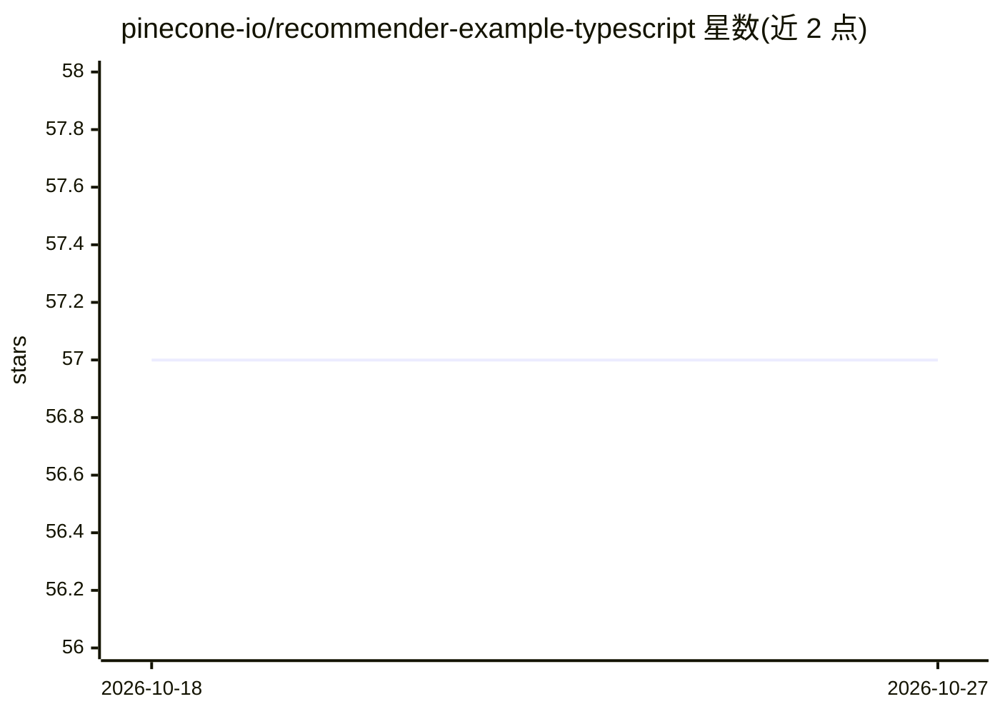

# pinecone-io/recommender-example-typescript

⭐ 57 · TypeScript · MIT · 推送 2026-10-26 · [GitHub](https://github.com/pinecone-io/recommender-example-typescript) · 组织维护

**TypeScript 示例：基于 Pinecone 向量检索的文章推荐器**

Pinecone 官方维护的 TypeScript 教程工程，演示用向量相似度检索实现基于内容的文章推荐：将 270 万篇美国新闻文章数据集（示例仅用前 10 万条）分块生成嵌入并批量 upsert 到 Pinecone serverless 索引；推荐时模拟用户已读文章，取其嵌入均值构造用户向量，查询索引并过滤已读文章后输出 top-10 推荐。运行需配置 Pinecone API key 与索引的云/区域参数，通过 npm 脚本执行索引与查询两个流程。

## 筛选速览

| 维度 | 判定 | 备注 |
|---|---|---|
| AI 角色 | `ai-ecosystem` | LLM/agent 周边工具 |
| 许可风险 | `permissive` | MIT |
| 部署形态 | `library` | 以包/库形式分发 |
| 模型依赖 | — | README 未给出锁定关系 |
| 硬件要求 | — | 无带数字的原话,不猜 |
| 安装摩擦 | `low` | 无编译、无系统依赖或容器化 |
| 成熟度 | — | 结构信号不足 |

## 能力要点

- 生成器函数分块处理 CSV 并批量 upsert 嵌入到 Pinecone
- 基于已读文章嵌入均值构造用户兴趣向量进行推荐查询
- 过滤用户已读文章后输出 top-10 推荐并表格打印

## 适用场景

- 学习如何在 Pinecone 上构建基于内容的推荐流程
- 参考嵌入生成与批量 upsert 的 TypeScript 实现模式
- 快速跑通一个文章个性化推荐 demo

## 场景标签

`推荐系统` `教程课程` · 领域:学习与行业

## 证据(README 行号)

> L3: This tutorial demonstrates how to use Pinecone's similarity search to create a simple personalized article or conten
> L62: To load data into our index, we need to create embeddings and upsert records into Pinecone. Run `npm run index` to 

## 星数曲线

2026-10-18 57 → 2026-10-27 57（+0）

---
*卡片 v1 · prompt 1.4 · 生成 2026-10-24 · 置信度 high · 依据 README sha `7298328b4993` · [字段定义](../../DATASET.md)*
