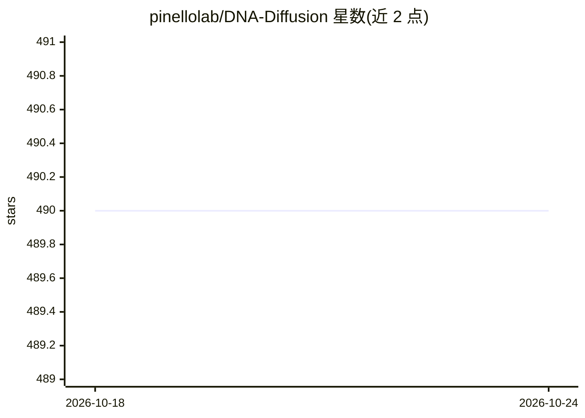

# pinellolab/DNA-Diffusion

⭐ 490 · Python · NOASSERTION · 推送 2026-10-22 · [GitHub](https://github.com/pinellolab/DNA-Diffusion) · [官网](https://pinellolab.github.io/DNA-Diffusion/) · 组织维护

**扩散模型生成 200bp 细胞类型特异调控 DNA 序列**

DNA-Diffusion 是基于扩散概率模型的调控 DNA 序列生成工具：生成 200bp、细胞类型特异的合成调控元件。提供数据集复现（DHS Index 约 359 万条序列）、训练脚本（默认至少 2000 epoch）、Hugging Face 模型 checkpoint 下载与序列采样（含 guidance scale 与细胞类型指定）。使用 uv 管理 Python 环境，兼容 CPU 与 GPU，偏好 Linux 加近期 GPU（如 A100）。支持接入自定义数据，要求序列 200bp、离散细胞类型标签，非 200bp 需改代码且效果可能下降。提供 Colab 训练与采样示例 notebook。

## 筛选速览

| 维度 | 判定 | 备注 |
|---|---|---|
| AI 角色 | `ai-native` | 本体是模型或模型工具 |
| 许可风险 | `none` | NOASSERTION |
| 部署形态 | `library` | 以包/库形式分发 |
| 模型依赖 | — | README 未给出锁定关系 |
| 硬件要求 | — | 无带数字的原话,不猜 |
| 安装摩擦 | `low` | 无编译、无系统依赖或容器化 |
| 成熟度 | — | 结构信号不足 |

## 能力要点

- 生成细胞类型特异的 200bp 合成调控元件
- Hugging Face 托管模型 checkpoint，支持 pt/safetensors 格式
- 可复现数据集构建（约 359 万条 DHS Index 序列）与训练流程
- 支持自有数据训练，可调 guidance scale 与指定细胞类型采样

## 适用场景

- 生成特定细胞类型的合成调控 DNA 序列用于下游分析
- 基于自有 DHS 数据重新训练扩散模型
- 复现论文的数据处理、训练与采样流程

## 场景标签

 · 领域:基因组学/生成式 AI

## 证据(README 行号)

> L5:  Generative modeling of regulatory DNA sequences with diffusion probabilistic models.
> L23: DNA-Diffusion is diffusion-based model for generation of 200bp cell type-specific synthetic regulatory elements.

## 星数曲线

2026-10-18 490 → 2026-10-24 490（+0）

---
*卡片 v1 · prompt 1.4 · 生成 2026-10-21 · 置信度 mid · 依据 README sha `e65d63700598` · [字段定义](../../DATASET.md)*
