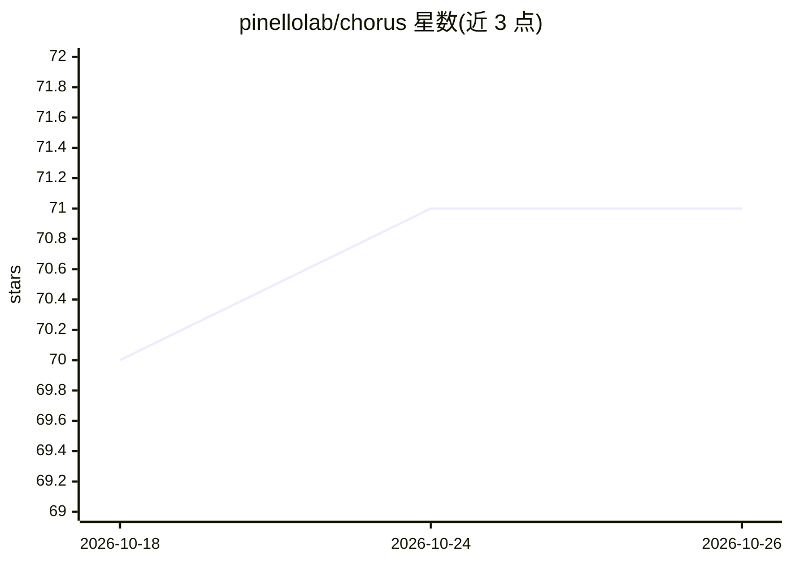

# pinellolab/chorus

⭐ 71 · Python · MIT · 推送 2026-10-15 · [GitHub](https://github.com/pinellolab/chorus) · 组织维护

**统一调用八个基因组深度学习模型的变异效应预测工具**

将 Enformer、AlphaGenome、Borzoi、ChromBPNet 等八个基因组序列到功能的深度学习模型封装在一个 Python API 之后，预测遗传变异对染色质可及性、转录因子结合、组蛋白标记与基因表达的影响，覆盖数千种细胞类型；每次预测附带基于背景分布校准的效应/活性百分位。另提供 27 工具的 MCP 服务器，可在 Claude Code 中用自然语言驱动分析。每个模型运行在独立 conda 环境中，权重与参考文件预置到 HuggingFace 组织；全量安装需约 100 GB 磁盘与 Linux x86_64/macOS，单模型约 13 GiB，不通过 PyPI 发布。

## 筛选速览

| 维度 | 判定 | 备注 |
|---|---|---|
| AI 角色 | `ai-native` | 本体是模型或模型工具 |
| 许可风险 | `permissive` | MIT |
| 部署形态 | `library` | 以包/库形式分发 |
| 模型依赖 | — | README 未给出锁定关系 |
| 硬件要求 | `cpu-ok` | |
| 安装摩擦 | `medium` | 含编译或系统依赖之一 |
| 成熟度 | — | 结构信号不足 |

## 能力要点

- 一个 API 封装 8 个基因组深度学习模型（Enformer/AlphaGenome/Borzoi/ChromBPNet 等）
- 每条预测附带校准的效应与活性百分位（对照 1.8 万–32.5 万采样位点）
- 27 工具 MCP 服务器，支持在 Claude Code 中用自然语言执行分析
- GPU 自动检测（CUDA/MPS/CPU），Enformer 可 CPU 运行

## 适用场景

- 预测某个 SNP 在特定细胞类型中对基因调控的影响
- 对 GWAS/临床变异做批量评分或致病位点精细定位
- 在 Claude Code 里用自然语言完成变异分析与多模型交叉验证
- 评估工程化序列编辑（区域替换）的调控效应

## 场景标签

 · 领域:基因组学/生物信息学

## 证据(README 行号)

> L112: **Conversational genomics.** The idea behind Chorus: ask in plain language what DNA does — and what happens when y
> L114: Eight genomic deep-learning models — Enformer, Borzoi, ChromBPNet/BPNet, Cherimoya/CATv1, Sei, LegNet, EPInformer-
> L118: Each oracle runs in its own conda environment (no TF/PyTorch/JAX dependency hell), every weight + reference + back

## 星数曲线

2026-10-18 70 → 2026-10-26 71（+1）

---
*卡片 v1 · prompt 1.4 · 生成 2026-10-24 · 置信度 mid · 依据 README sha `825609547f9e` · [字段定义](../../DATASET.md)*
