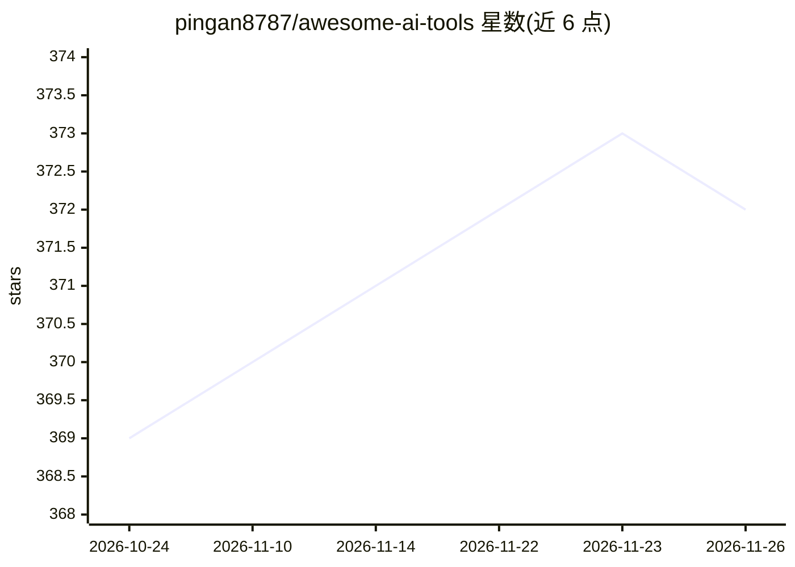

# pingan8787/awesome-ai-tools

⭐ 372 · 推送 2026-11-07 · [GitHub](https://github.com/pingan8787/awesome-ai-tools) · 个人维护

**面向需要查找 AI 工具的用户的多类别工具链接目录**

一个 awesome 风格的 AI 工具聚合清单，按图像与艺术生成等多个类别组织，以字母序罗列工具名称、一句描述和官网链接。README 中除目录外还包括赞助位（如 WiseMindAI、ChatTOC）。清单本身不提供代码或安装方式，条目均为第三方在线服务或应用的链接，更新与收录范围由维护者手动维护。

## 筛选速览

| 维度 | 判定 | 备注 |
|---|---|---|
| AI 角色 | `ai-knowledge` | 知识聚合/清单类 |
| 许可风险 | `none` | — |
| 部署形态 | `None` |  |
| 模型依赖 | — | README 未给出锁定关系 |
| 硬件要求 | — | 无带数字的原话,不猜 |
| 安装摩擦 | `low` | 无编译、无系统依赖或容器化 |
| 成熟度 | — | 结构信号不足 |

## 能力要点

- 按类别组织的 AI 工具链接清单
- 每条目附一句功能描述与官网链接
- 以字母序排列便于查找

## 适用场景

- 按类别浏览可用的 AI 图像生成等工具
- 为选型收集 AI 工具候选名单
- 查找某类工具的官方网站入口

## 场景标签

`精选清单` · 领域:学习与行业

## 证据(README 行号)

> L1: # Awesome AI Tools
> L15: （目录 31 行略）
> L17: ## 1. 📷 Image & Art Generation

## 星数曲线

2026-10-24 369 → 2026-11-26 372（+3）

---
*卡片 v1 · prompt 1.4 · 生成 2026-11-26 · 置信度 high · 依据 README sha `53b7c045daa4` · [字段定义](../../DATASET.md)*
