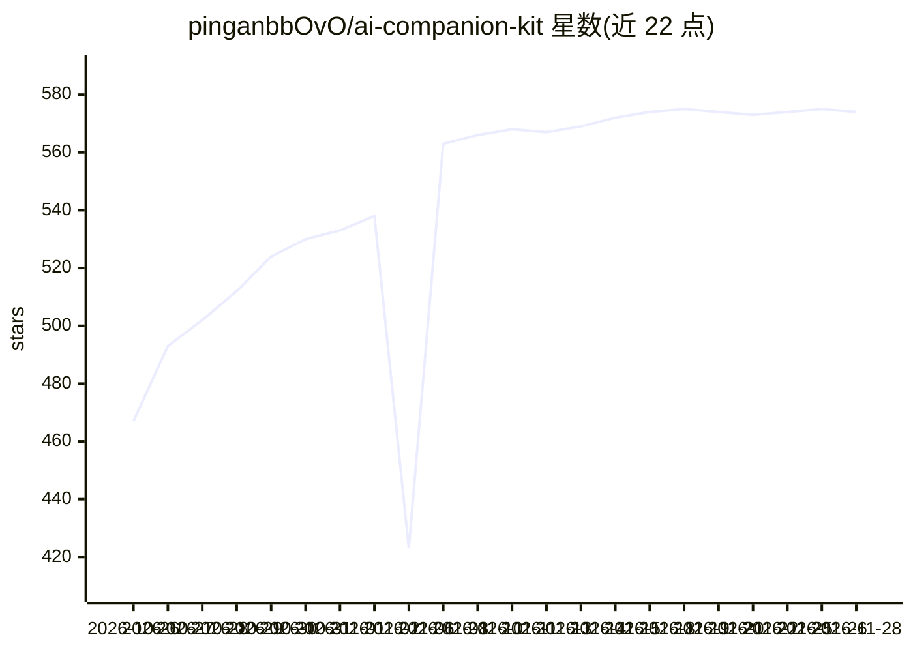

# pinganbbOvO/ai-companion-kit

⭐ 574 · JavaScript · MIT · 推送 2026-10-26 · [GitHub](https://github.com/pinganbbOvO/ai-companion-kit) · 个人维护 · 中文 README

**QQ 陪聊机器人 + 安卓手机控制 MCP 工具包**

由三个可独立使用的包组成：ai-companion 提供按人存储的记忆账本、拟人化发送节奏、条件唤醒策略与角色卡；phone-mcp 提供 34 个通过 adb 驱动安卓真机或模拟器的 MCP 工具；qzone 支持让 AI 自主发说说、点赞、评论并内置限流。另有定时静默唤醒与自动日记功能。数据以 JSON/JSONL 纯文本存储于本地。前置依赖 Node.js 与一个能连 QQ 的 OneBot 网关（SnowLuma）。

## 筛选速览

| 维度 | 判定 | 备注 |
|---|---|---|
| AI 角色 | `ai-native` | 本体是模型或模型工具 |
| 许可风险 | `permissive` | MIT |
| 部署形态 | `library` | 以包/库形式分发 |
| 模型依赖 | — | README 未给出锁定关系 |
| 硬件要求 | — | 无带数字的原话,不猜 |
| 安装摩擦 | `low` | 无编译、无系统依赖或容器化 |
| 成熟度 | — | 结构信号不足 |

## 能力要点

- 记忆按人存储、跨会话与跨场合共享一条对话流
- 34 个 MCP 工具通过 adb 控制安卓真机或模拟器
- 拟人化发送：打字时长、自动分条、条间停顿
- QQ 空间操作内置限流与图片目录白名单

## 适用场景

- 搭一个记得住我的 QQ 陪聊机器人
- 让 AI 代为操作安卓手机完成签到等动作
- 给 AI 角色加自动日记与定时自主行为

## 场景标签

`聊天机器人` `GUI 自动化` · 领域:效率与自动化

## 证据(README 行号)

> L46: |🤖 **ai-companion**|让它**记得住你**、**打字像人**、**知道什么时候该闭嘴**|角色卡 · 记忆账本 · 拟人化发送 · 唤醒策略|
> L301: |碰不到手机|`phone-mcp`|34 个 MCP 工具，通过 adb 驱动真机或模拟器|

## 星数曲线

2026-10-26 467 → 2026-11-28 574（+107）

---
*卡片 v1 · prompt 1.4 · 生成 2026-11-25 · 置信度 high · 依据 README sha `51049b2ef44f` · [字段定义](../../DATASET.md)*
