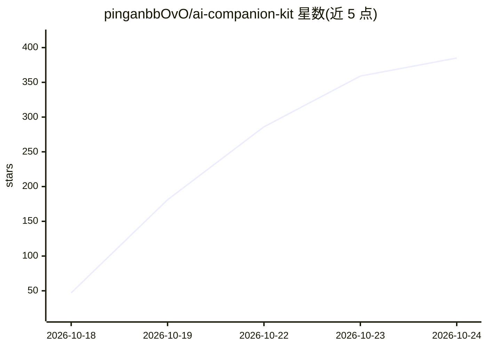

# pinganbbOvO/ai-companion-kit

⭐ 423 · JavaScript · MIT · 推送 2026-10-21 · [GitHub](https://github.com/pinganbbOvO/ai-companion-kit) · 个人维护 · 中文 README

**给个人用户的 QQ 陪聊 AI 与安卓手机控制 MCP 工具包**

由三个可独立使用的 Node.js 包组成：ai-companion 提供按人存储的记忆账本、拟人化发送（打字时长/分条/深夜变慢）、唤醒策略与角色卡；phone-mcp 通过 adb 提供 34 个 MCP 工具驱动真机或模拟器；qzone/qzone-mcp 让 AI 自主发 QQ 空间说说，带限额与图片目录白名单。面向想搭建个人 QQ 聊天机器人的普通用户与开发者，提供 Windows 一键安装脚本。依赖 OneBot 网关（SnowLuma）连接 QQ，需自备 OpenAI 格式 API key；README 提示 QQ 自动化存在腾讯风控风险。

## 筛选速览

| 维度 | 判定 | 备注 |
|---|---|---|
| AI 角色 | `ai-native` | 本体是模型或模型工具 |
| 许可风险 | `permissive` | MIT |
| 部署形态 | `library` | 以包/库形式分发 |
| 模型依赖 | — | README 未给出锁定关系 |
| 硬件要求 | — | 无带数字的原话,不猜 |
| 安装摩擦 | `low` | 无编译、无系统依赖或容器化 |
| 成熟度 | — | 结构信号不足 |

## 能力要点

- 记忆按人存储、跨场合共享对话流，数据为 JSON/JSONL 纯文本
- 34 个 MCP 手机控制工具，通过 adb 驱动真机或模拟器
- qzone 七个工具带分钟/天级限额，图片仅从白名单目录发送
- 拟人化发送（Humanizer）与多条件独立唤醒策略（Waker）

## 适用场景

- 搭一个记得住我的 QQ 聊天机器人
- 让 AI 替我在手机上签到、刷视频、做操作
- 让 AI 自主决定时机发 QQ 空间说说和写日记

## 场景标签

`聊天机器人` `GUI 自动化` · 领域:效率与自动化

## 证据(README 行号)

> L46: |🤖 **ai-companion**|让它**记得住你**、**打字像人**、**知道什么时候该闭嘴**|角色卡 · 记忆账本 · 拟人化发送 · 唤醒策略|
> L50: 拼起来就是一只**住在 QQ 里、还长着手**的 AI。

## 星数曲线

2026-10-18 47 → 2026-10-24 385（+338）

---
*卡片 v1 · prompt 1.4 · 生成 2026-10-22 · 置信度 high · 依据 README sha `bc8b1c4b5d0a` · [字段定义](../../DATASET.md)*
