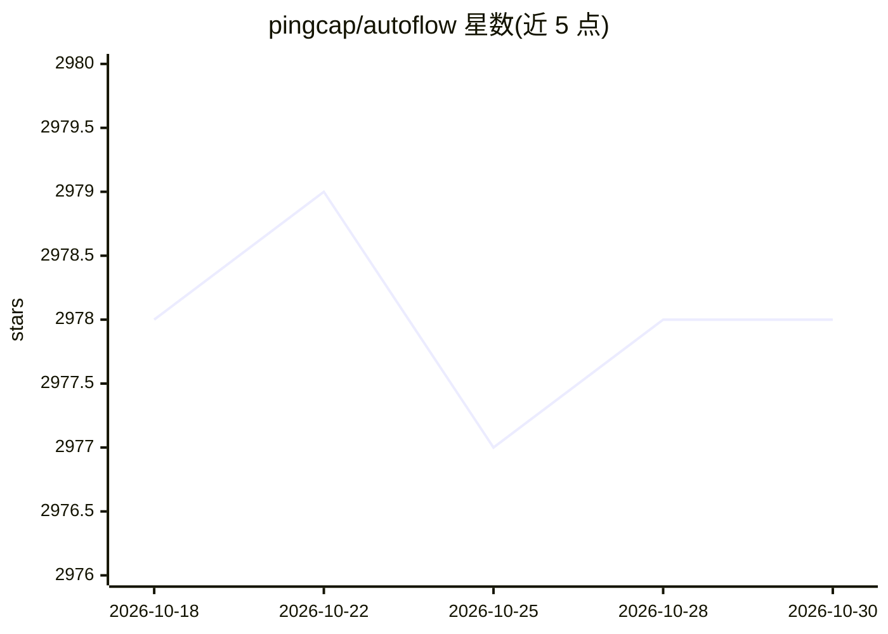

# pingcap/autoflow

⭐ 2,978 · TypeScript · Apache-2.0 · 推送 2026-10-23 · [GitHub](https://github.com/pingcap/autoflow) · [官网](https://tidb.ai) · 组织维护

**基于 Graph RAG 的对话式知识库工具，可嵌入网站**

PingCAP 开源的 Graph RAG 知识库工具，基于 TiDB Serverless 向量存储，RAG 框架采用 LlamaIndex 与 DSPy。提供 Perplexity 风格的对话搜索页面，内置网站爬虫（通过 sitemap 抓取官方与文档站点），并支持以 JavaScript 代码片段形式将对话搜索窗口嵌入第三方网站。部署方式为 Docker Compose，处于早期开发阶段，计划后续打包为 Python 包。

## 筛选速览

| 维度 | 判定 | 备注 |
|---|---|---|
| AI 角色 | `ai-native` | 本体是模型或模型工具 |
| 许可风险 | `permissive` | Apache-2.0 |
| 部署形态 | `self-host` | docker 或自建部署 |
| 模型依赖 | — | README 未给出锁定关系 |
| 硬件要求 | — | 无带数字的原话,不猜 |
| 安装摩擦 | `low` | 无编译、无系统依赖或容器化 |
| 成熟度 | `idea` | |

## 能力要点

- Graph RAG（知识图谱 + RAG）构建知识库
- 内置网站爬虫，通过 sitemap 抓取文档站点
- 可嵌入网站的 JavaScript 对话搜索组件
- 基于 TiDB 向量存储与 LlamaIndex/DSPy

## 适用场景

- 为产品文档站搭建对话式搜索
- 将 AI 问答窗口嵌入自己的网站
- 抓取并检索官方文档站点内容

## 场景标签

`聊天机器人` `RAG` `文档问答` `网页抓取` · 领域:效率与自动化

## 证据(README 行号)

> L17: AutoFlow is an open source graph rag (graphrag: knowledge graph rag) based knowledge base tool built on top of TiDB
> L24: 1. **Perplexity-style Conversational Search page**: Our platform features an advanced built-in website crawler, des

## 星数曲线

2026-10-18 2,978 → 2026-10-30 2,978（+0）

---
*卡片 v1 · prompt 1.4 · 生成 2026-10-20 · 置信度 mid · 依据 README sha `4695a2a23464` · [字段定义](../../DATASET.md)*
