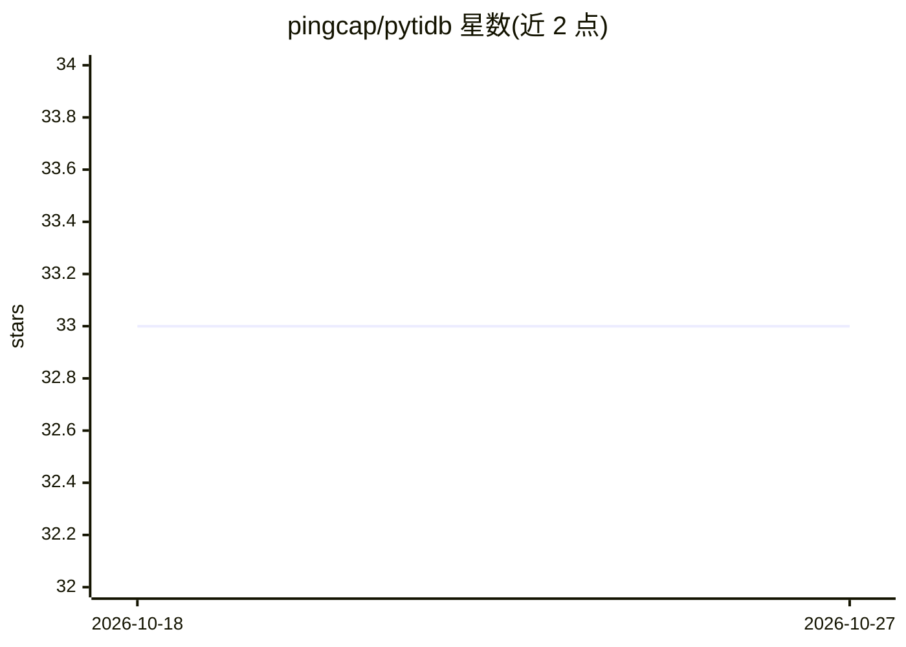

# pingcap/pytidb

⭐ 33 · Python · Apache-2.0 · 推送 2026-03-06 · [GitHub](https://github.com/pingcap/pytidb) · [官网](https://docs.pingcap.com/ai) · 组织维护

**面向 AI 应用的 TiDB Python SDK：统一向量/全文/混合检索数据层**

PingCAP 维护的 Python SDK，封装 TiDB 作为 AI 应用与 Agent 的统一数据平台：自动将文本字段嵌入并存储为向量，支持向量/全文/混合三种检索模式，提供文本到图像与图像到图像检索、多算子过滤与可选重排、结构化与非结构化数据 Join、事务管理。需连接 TiDB 集群（可在 TiDB Cloud 免费创建）。README 声明包处于快速开发期，API 可能变化，建议安装固定版本。另提供内置 MCP 支持与发布为 AWS Marketplace AI 工具的扩展。

## 筛选速览

| 维度 | 判定 | 备注 |
|---|---|---|
| AI 角色 | `ai-ecosystem` | LLM/agent 周边工具 |
| 许可风险 | `permissive` | Apache-2.0 |
| 部署形态 | `library` | 以包/库形式分发 |
| 模型依赖 | — | README 未给出锁定关系 |
| 硬件要求 | — | 无带数字的原话,不猜 |
| 安装摩擦 | `low` | 无编译、无系统依赖或容器化 |
| 成熟度 | `idea` | |

## 能力要点

- 向量/全文/混合三种统一检索模式
- 文本字段自动嵌入与多模态存储
- 文本到图像、图像到图像检索
- 事务管理与 MCP 支持

## 适用场景

- 为 RAG 应用构建带检索的数据层
- 在同一个库中做向量与全文混合搜索
- 把结构化表与非结构化数据 Join 查询

## 场景标签

`向量数据库` · 领域:知识与检索

## 证据(README 行号)

> L21: **Python SDK for TiDB AI**: A unified data platform empowering developers to build next-generation AI applications.
> L23: - 🔍 **Unified Search Modes**: Vector · Full‑Text · Hybrid

## 星数曲线

2026-10-18 33 → 2026-10-27 33（+0）

---
*卡片 v1 · prompt 1.4 · 生成 2026-10-25 · 置信度 high · 依据 README sha `8744e8bd4cdb` · [字段定义](../../DATASET.md)*
