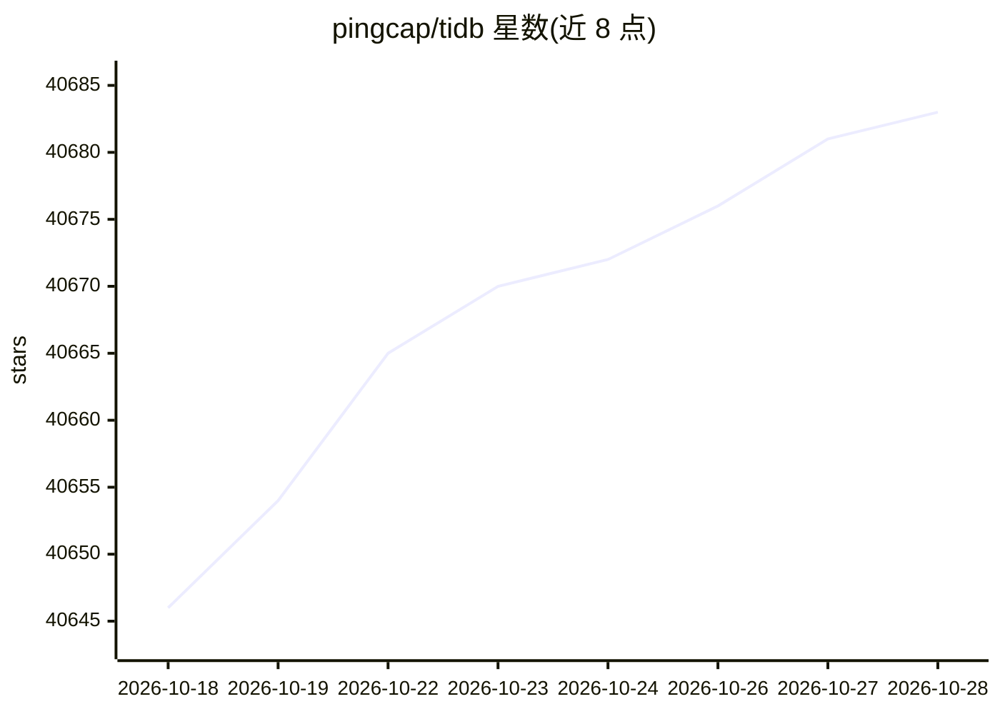

# pingcap/tidb

⭐ 40,685 · Go · Apache-2.0 · 推送 2026-10-28 · [GitHub](https://github.com/pingcap/tidb) · [官网](https://www.tidb.io/) · 组织维护 · 中文 README

**开源分布式 SQL 数据库：面向事务、分析与向量检索负载**

TiDB 是开源、云原生的分布式 SQL 数据库，采用存算分离架构，通过两阶段提交与 Raft 协议提供分布式事务、强一致与高可用。内置 TiKV 行存与 TiFlash 列存双引擎，支持 HTAP 混合负载；兼容 MySQL 8.0 协议与工具生态，提供迁移工具；支持向量搜索。可部署于本地、公有云或 Kubernetes（TiDB Operator），亦提供全托管的 TiDB Cloud（含免费计划）。以 Go 编写，Apache 2.0 许可。

## 筛选速览

| 维度 | 判定 | 备注 |
|---|---|---|
| AI 角色 | `ai-ecosystem` | LLM/agent 周边工具 |
| 许可风险 | `permissive` | Apache-2.0 |
| 部署形态 | `None` |  |
| 模型依赖 | — | README 未给出锁定关系 |
| 硬件要求 | — | 无带数字的原话,不猜 |
| 安装摩擦 | `low` | 无编译、无系统依赖或容器化 |
| 成熟度 | — | 结构信号不足 |

## 动量与使用信号

- 维护:`active` — 距上次 push 1.3 天,年发版 6,390 位贡献者
- 涨星:近 1 天 **+1**(自 20261016 起算)

## 能力要点

- 两阶段提交 + Raft 多副本的分布式事务与自动故障转移
- TiKV 行存与 TiFlash 列存双引擎 HTAP 架构
- 兼容 MySQL 8.0 协议、框架与工具，支持向量搜索
- 支持本地、Kubernetes（TiDB Operator）与 TiDB Cloud 托管部署

## 适用场景

- 为水平扩展的 OLTP 应用替换 MySQL 后端
- 在同一数据库中同时运行交易与分析查询
- 在 Kubernetes 上自管理分布式数据库集群
- 为 AI 应用存储事务数据并执行向量检索

## 场景标签

 · 领域:数据库/基础设施

## 证据(README 行号)

> L14: TiDB (/’taɪdiːbi:/, "Ti" stands for Titanium) is an open-source, cloud-native, distributed SQL database designed fo
> L26: - **Hybrid Transactional/Analytical Processing (HTAP)**: TiDB provides two storage engines: TiKV, a row-based stora
> L28: - **Cloud-Native**: TiDB can be deployed in public clouds, on-premises, or natively in Kubernetes. TiDB Operator he

## 星数曲线

2026-10-18 40,646 → 2026-10-28 40,683（+37）

---
*卡片 v1 · prompt 1.4 · 生成 2026-10-18 · 置信度 high · 依据 README sha `af96c39633d3` · [字段定义](../../DATASET.md)*
