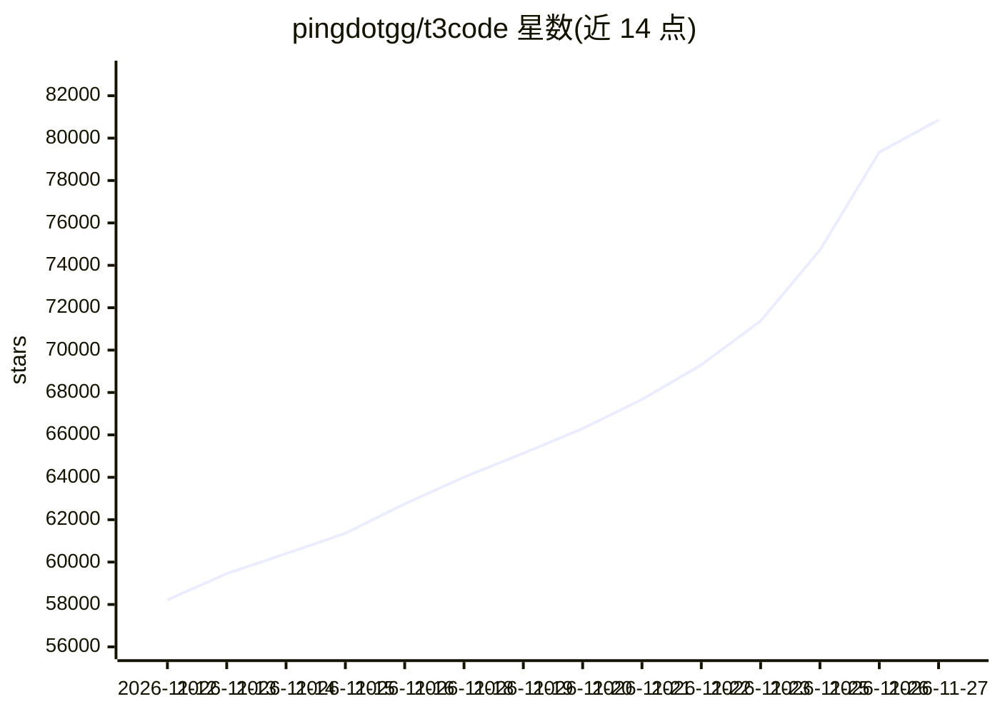

# pingdotgg/t3code

⭐ 80,856 · TypeScript · MIT · 推送 2026-11-26 · [GitHub](https://github.com/pingdotgg/t3code) · [官网](https://t3.codes) · 组织维护

**在桌面与手机统一操控本机编码 agent 的控制面**

T3 Code 在用户自己的机器上运行已有的编码 agent（Claude Code、Codex、Cursor、OpenCode 等），将它们汇总到一个界面：线程可在桌面发起、手机批准下一步；每个线程可用独立 git worktree，提供 diff 审查与一键 commit/push/开 PR；可通过局域网、Tailscale 或 T3 Connect 远程访问。不转售 token，要求本机已有已登录的 agent。提供桌面端（macOS/Windows/Linux）、Web、CLI 及 iOS/Android 应用，源码 MIT 许可，商标与品牌不受 MIT 覆盖，fork 需更换品牌。

## 筛选速览

| 维度 | 判定 | 备注 |
|---|---|---|
| AI 角色 | `ai-ecosystem` | LLM/agent 周边工具 |
| 许可风险 | `permissive` | MIT |
| 部署形态 | `library` | 以包/库形式分发 |
| 模型依赖 | — | README 未给出锁定关系 |
| 硬件要求 | — | 无带数字的原话,不猜 |
| 安装摩擦 | `low` | 无编译、无系统依赖或容器化 |
| 成熟度 | — | 结构信号不足 |

## 能力要点

- 一个界面控制本机多个编码 agent，线程中途可切换模型
- 桌面/手机/Web 共享同一服务器的线程状态，支持远程连接
- 线程级 git worktree、diff 审查与一键提交/推送/开 PR
- 源码 MIT 许可，允许 fork 但需替换商标与品牌

## 适用场景

- 在手机上远程批准家里/公司电脑上 agent 的下一步操作
- 在同一个界面中管理多个编码 agent 并中途交接任务
- 用 worktree 隔离不同 agent 线程并快速走完 git 流程

## 场景标签

`编码 Agent` · 领域:编码与开发

## 证据(README 行号)

> L7:  The open-source control plane for coding agents.
> L20: T3 Code runs the coding agents on your machine and gives them one fast interface. Start a thread at your desk, then
> L22: It works with Claude Code, Codex, Cursor, OpenCode, Grok Build, Antigravity, Kiro, Pi, Muse Code, fx, and any ACP a

## 星数曲线

2026-11-12 58,213 → 2026-11-27 80,856（+22,643）

---
*卡片 v1 · prompt 1.4 · 生成 2026-11-26 · 置信度 high · 依据 README sha `60944e8295b6` · [字段定义](../../DATASET.md)*
