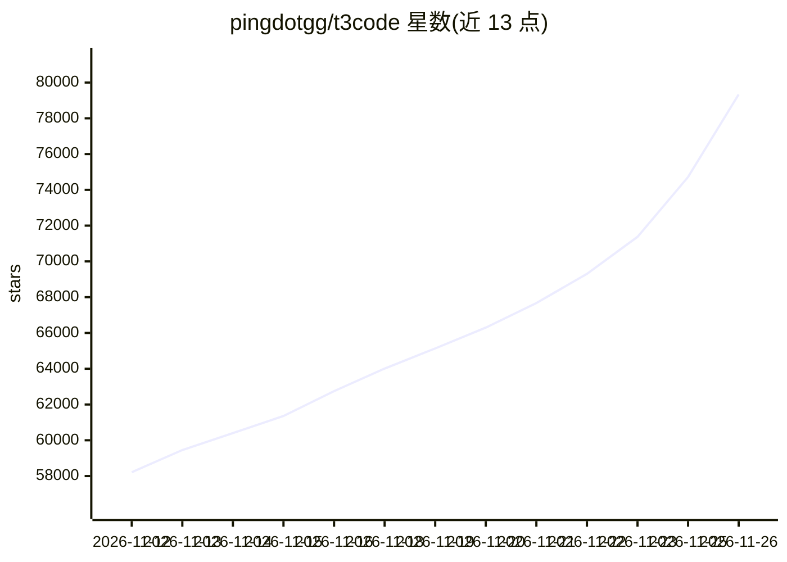

# pingdotgg/t3code

⭐ 79,334 · TypeScript · MIT · 推送 2026-11-25 · [GitHub](https://github.com/pingdotgg/t3code) · [官网](https://t3.codes) · 组织维护

**在手机/电脑上统一控制多个编码 Agent 的控制台**

T3 Code 是一个开源编码 Agent 控制平面：在本机运行用户已登录的编码 Agent（Claude Code、Codex、Cursor、OpenCode 及任意 ACP Agent），提供统一界面管理线程、切换模型、跨 Agent 交接任务。支持桌面、Web 与 iOS/Android 客户端共用一个服务器同步线程，内置 Git worktree 隔离、diff 审查与一键提交/推送/开 PR，可通过局域网、Tailscale 或 T3 Connect 远程访问。MIT 许可，不转售 token，依赖用户已有的 Agent 订阅。

## 筛选速览

| 维度 | 判定 | 备注 |
|---|---|---|
| AI 角色 | `ai-ecosystem` | LLM/agent 周边工具 |
| 许可风险 | `permissive` | MIT |
| 部署形态 | `library` | 以包/库形式分发 |
| 模型依赖 | — | README 未给出锁定关系 |
| 硬件要求 | — | 无带数字的原话,不猜 |
| 安装摩擦 | `low` | 无编译、无系统依赖或容器化 |
| 成熟度 | — | 结构信号不足 |

## 能力要点

- 统一界面控制 Claude Code、Codex、Cursor 及任意 ACP Agent
- 桌面/Web/iOS/Android 客户端共享同一服务器与线程
- 内置 Git worktree 隔离与一键提交、推送、开 PR
- 提供 brew/winget/scoop/nix/脚本等多种安装方式

## 适用场景

- 在办公室电脑发起 Agent 任务，用手机批准下一步操作
- 把多个编码 Agent 收拢到一个界面统一管理
- 通过 Tailscale 从外部机器远程控制家里的 Agent

## 场景标签

`编码 Agent` · 领域:编码与开发

## 证据(README 行号)

> L7:  The open-source control plane for coding agents.
> L20: T3 Code runs the coding agents on your machine and gives them one fast interface. Start a thread at your desk, then
> L22: It works with Claude Code, Codex, Cursor, OpenCode, Grok Build, Antigravity, Kiro, Pi, Muse Code, fx, and any ACP a

## 星数曲线

2026-11-12 58,213 → 2026-11-26 79,334（+21,121）

---
*卡片 v1 · prompt 1.4 · 生成 2026-11-24 · 置信度 high · 依据 README sha `ca361ac9fc1b` · [字段定义](../../DATASET.md)*
