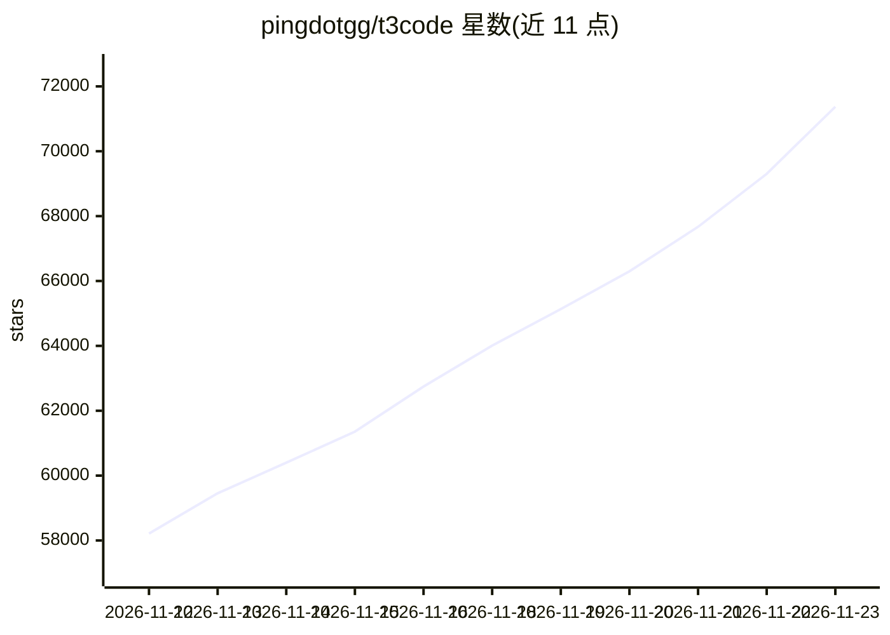

# pingdotgg/t3code

⭐ 71,373 · TypeScript · MIT · 推送 2026-11-22 · [GitHub](https://github.com/pingdotgg/t3code) · [官网](https://t3.codes) · 组织维护

**在电脑和手机上统一操控本地编码 agent 的开源控制平面**

T3 Code 在用户机器上运行编码 agent 并提供统一界面：桌面端、Web 端与 iOS/Android 应用连接同一服务器，可从手机审批 agent 的下一步操作。支持驱动 Claude Code、Codex、Cursor、OpenCode、Grok Build 等已安装并登录的 agent，可在对话中途切换模型或让不同 agent 交接任务。内置 Git worktree、diff 审查与一键提交/PR。MIT 许可，提供桌面安装包、命令行安装脚本与移动应用；使用前提是至少一个 agent 已安装登录。

## 筛选速览

| 维度 | 判定 | 备注 |
|---|---|---|
| AI 角色 | `ai-ecosystem` | LLM/agent 周边工具 |
| 许可风险 | `permissive` | MIT |
| 部署形态 | `library` | 以包/库形式分发 |
| 模型依赖 | — | README 未给出锁定关系 |
| 硬件要求 | — | 无带数字的原话,不猜 |
| 安装摩擦 | `low` | 无编译、无系统依赖或容器化 |
| 成熟度 | — | 结构信号不足 |

## 能力要点

- 一个服务器驱动多个编码 agent，桌面/Web/手机客户端同步线程
- 支持中途切换模型与跨 agent 任务交接
- 基于 Git worktree 的线程隔离、diff 审查与一键 PR
- 本地网络、Tailscale 或 T3 Connect 远程接入

## 适用场景

- 在电脑上开启 agent 任务，路上用手机继续审批
- 把多个已订阅的编码 agent 收进一个界面统一管理
- 让不同 agent 在各自 worktree 中并行处理任务

## 场景标签

`编码 Agent` · 领域:编码与开发

## 证据(README 行号)

> L20: T3 Code runs the coding agents on your machine and gives them one fast interface. Start a thread at your desk, then
> L22: It works with Claude Code, Codex, Cursor, OpenCode, Grok Build, Antigravity, Kiro, Pi, Muse Code, fx, and any ACP a
> L28: - **Desktop, web, and phone.** One server, and every client shows the same threads. There are apps for iOS and Andr

## 星数曲线

2026-11-12 58,213 → 2026-11-23 71,373（+13,160）

---
*卡片 v1 · prompt 1.4 · 生成 2026-11-17 · 置信度 mid · 依据 README sha `44cfed83b927` · [字段定义](../../DATASET.md)*
