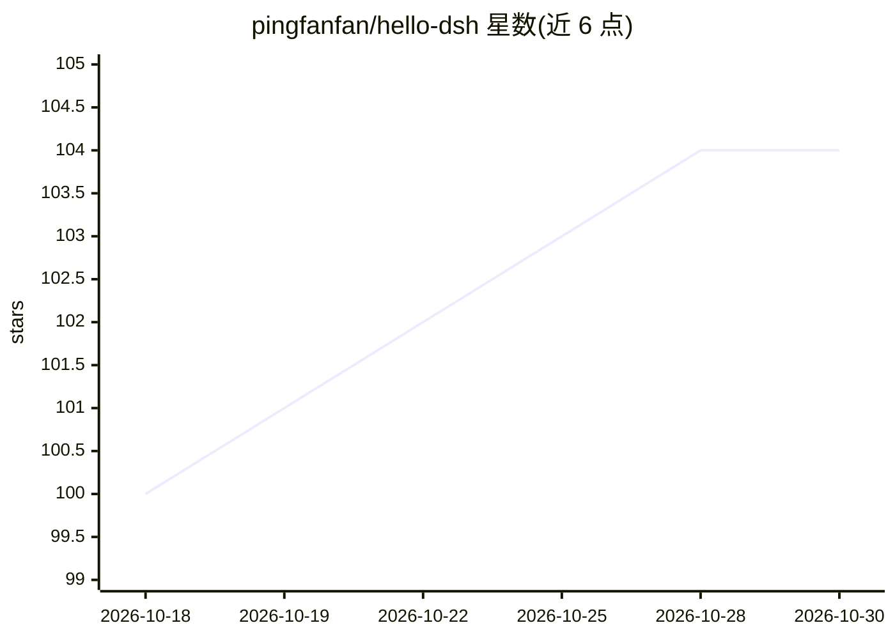

# pingfanfan/hello-dsh

⭐ 104 · Python · MIT · 推送 2026-09-14 · [GitHub](https://github.com/pingfanfan/hello-dsh) · [官网](https://github.com/pingfanfan/hello-dsh/blob/main/docs/hello-dsh.md) · 个人维护 · 中文 README

**DeepSeek Harness 插件开发零基础中文教程，含 22 个技能实例**

面向零基础用户的 DeepSeek Harness（DSH）插件开发教程：从安装 Node.js、启动 DSH、配置 API key 到构建第一个插件并观察其生命周期，全程约 30 分钟，每节设检查点。讲解 Markdown 技能与 TypeScript 代码插件两条扩展路径，附 22 个中文技能实例（可通过 install.sh 或 AI 代装），并记录了在 DSH 0.1.0-rc.6 上实测的行为坑点与配套诊断工具 dsh-doctor。教程正文为中文，英文版编写中。

## 筛选速览

| 维度 | 判定 | 备注 |
|---|---|---|
| AI 角色 | `ai-knowledge` | 知识聚合/清单类 |
| 许可风险 | `permissive` | MIT |
| 部署形态 | `library` | 以包/库形式分发 |
| 模型依赖 | — | README 未给出锁定关系 |
| 硬件要求 | — | 无带数字的原话,不猜 |
| 安装摩擦 | `low` | 无编译、无系统依赖或容器化 |
| 成熟度 | — | 结构信号不足 |

## 能力要点

- 覆盖 133 个插件体系的两条扩展路径（Markdown 技能 / TypeScript 插件）
- 22 个中文技能实例，支持 install.sh 一键安装或 AI 代装
- 记录 web UI 技能默认关闭等实测坑点（0.1.0-rc.6）
- 配套 dsh-doctor 配置健康检查工具（npx 只读运行）

## 适用场景

- 零基础学习 DSH 插件系统的原理与开发
- 复用现成中文技能覆盖代码审查、调试、文档写作等场景
- 排查 DSH 启动与技能不生效等静默失败问题

## 场景标签

`教程课程` · 领域:学习与行业

## 证据(README 行号)

> L3: **The first lesson for DeepSeek Harness**
> L22: This repo walks you from "open a terminal" to building your own plugin and watching its lifecycle.
> L61: Once you're through the tutorial, `examples/skills/` has 22 Chinese-language skills ready to use.

## 星数曲线

2026-10-18 100 → 2026-10-30 104（+4）

---
*卡片 v1 · prompt 1.4 · 生成 2026-10-23 · 置信度 mid · 依据 README sha `9cd794c9f09e` · [字段定义](../../DATASET.md)*
