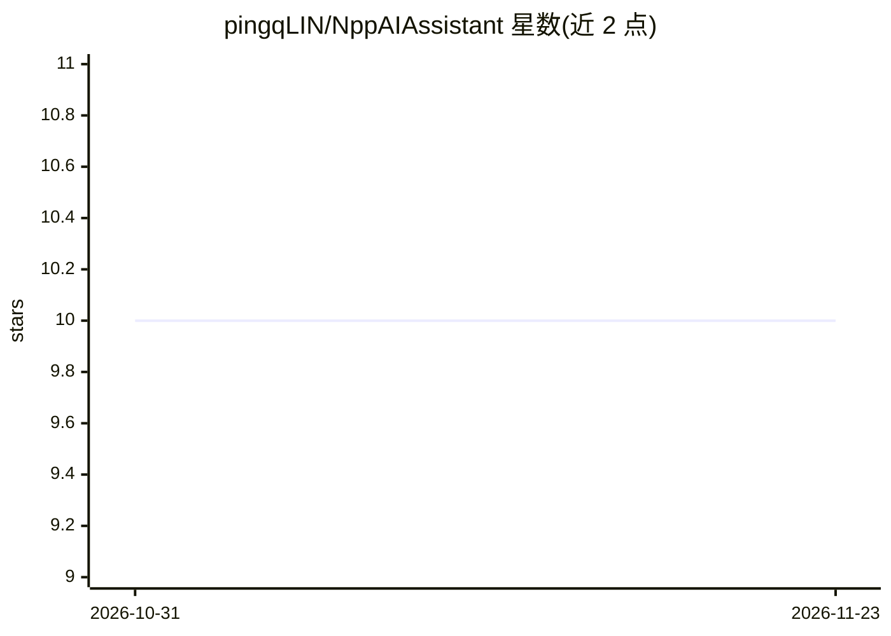

# pingqLIN/NppAIAssistant

⭐ 10 · C++ · NOASSERTION · 推送 2026-10-05 · [GitHub](https://github.com/pingqLIN/NppAIAssistant) · 个人维护 · 中文 README

**给 Notepad++ 用户的轻量 AI 助手插件，可查看提示词**

原生 Notepad++ 插件，对选中文本提供解释、改写、整理等模型能力，支持云端 API 与 LM Studio 本地端点。特点包括：发送前可检查组装后的提示词、默认单轮请求（对话分支不会自动成为模型上下文）、请求非流式、API 凭据用 Windows DPAPI 加密存储。安装方式为 Plugins Admin 或手动放置 DLL，仅提供 x64 版本；从源码构建需 Visual Studio C++ 工作负载与 CMake 3.21+。

## 筛选速览

| 维度 | 判定 | 备注 |
|---|---|---|
| AI 角色 | `ai-native` | 本体是模型或模型工具 |
| 许可风险 | `none` | NOASSERTION |
| 部署形态 | `desktop` | 安装包/桌面程序 |
| 模型依赖 | locked-api |  |
| 硬件要求 | — | 无带数字的原话,不猜 |
| 安装摩擦 | `medium` | 含编译或系统依赖之一 |
| 成熟度 | — | 结构信号不足 |

## 能力要点

- 发送前可查看组装后的完整提示词
- 默认单轮行为，对话分支不自动成为模型上下文
- 结构化 JSON 输出走原生 schema 传输并本地校验
- API 凭据经 Windows DPAPI 加密存储

## 适用场景

- 在 Notepad++ 内解释或改写选中的代码与文本
- 通过 LM Studio 本地端点离线处理草稿
- 需要审查每条提示词再发送的编辑流程

## 场景标签

`AI 助手` · 领域:对话与助手

## 证据(README 行号)

> L7: A native Notepad++ plugin that helps explain code, rewrite text, and organize drafts. Choose a cloud AI service or c
> L62: v0.2.0.6 implements OpenAI, Gemini, Claude, OpenRouter, LM Studio, and a generic OpenAI-compatible profile. Availab

## 星数曲线

2026-10-31 10 → 2026-11-23 10（+0）

---
*卡片 v1 · prompt 1.4 · 生成 2026-11-22 · 置信度 high · 依据 README sha `bbadc2fc0149` · [字段定义](../../DATASET.md)*
