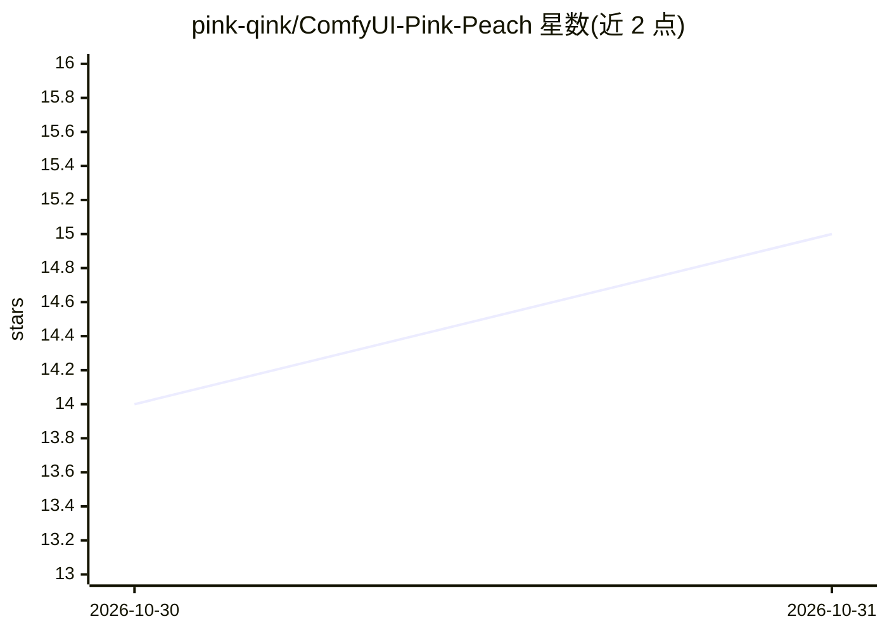

# pink-qink/ComfyUI-Pink-Peach

⭐ 15 · JavaScript · 推送 2026-10-28 · [GitHub](https://github.com/pink-qink/ComfyUI-Pink-Peach) · 个人维护

**面向 Krea 2 Turbo 的 ComfyUI 节点包：补齐生成全流程**

为 ComfyUI 定制的节点包，针对 Krea 2 Turbo 模型提供从模型加载到图像保存的完整生成管线：单一节点加载 UNET/CLIP(Qwen3-VL)/VAE、最多 10 个 LoRA 分层控制、NAG 在 CFG 1 下实现负向提示、Variance 节点注入语义噪声提升跨种子多样性、自定义调度器与采样器及低步数调度校准。另有 Qwen 图像反推提示词、后期处理套件与自定义粉色 UI。以 git clone 安装到 custom_nodes 目录运行。

## 筛选速览

| 维度 | 判定 | 备注 |
|---|---|---|
| AI 角色 | `ai-ecosystem` | LLM/agent 周边工具 |
| 许可风险 | `none` | — |
| 部署形态 | `None` |  |
| 模型依赖 | — | README 未给出锁定关系 |
| 硬件要求 | — | 无带数字的原话,不猜 |
| 安装摩擦 | `low` | 无编译、无系统依赖或容器化 |
| 成熟度 | — | 结构信号不足 |

## 能力要点

- All-in-One Loader 单节点加载 UNET/CLIP/VAE 并自动解包 fp8 文本编码器
- NAG 节点在 CFG 1 下于交叉注意力层实现负向引导
- Variance 节点在早期步注入语义噪声实现跨种子多样性
- 自定义调度器/采样器与低步数 Schedule Calibrator 校准

## 适用场景

- 在 ComfyUI 中搭建 Krea 2 Turbo 图像生成工作流
- 解决 Turbo 模型跨种子人脸趋同与负向提示失效问题
- 用 Qwen3-VL 从图像反推或扩写提示词

## 场景标签

`图像生成` · 领域:内容生成

## 证据(README 行号)

> L3: **A ComfyUI node pack tailored for Krea 2 Turbo.** A complete generation pipeline — from model loading to image savi
> L5: > Turbo models are lightning fast but notoriously finicky: they dislike CFG, ignore standard negative prompts, and t

## 星数曲线

2026-10-30 14 → 2026-10-31 15（+1）

---
*卡片 v1 · prompt 1.4 · 生成 2026-10-30 · 置信度 high · 依据 README sha `764bdd21ed95` · [字段定义](../../DATASET.md)*
