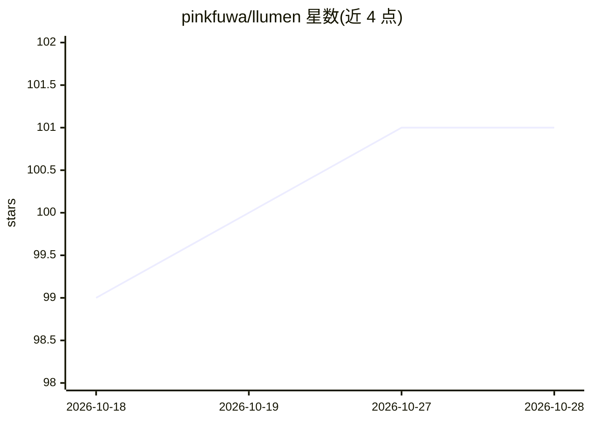

# pinkfuwa/llumen

⭐ 101 · Rust · NOASSERTION · 推送 2026-10-24 · [GitHub](https://github.com/pinkfuwa/llumen) · [官网](https://pinkfuwa.github.io/llumen/) · 个人维护 · 中文 README

**面向低配设备的自托管 LLM 聊天界面，零配置**

用 Rust 实现的轻量级自托管 LLM 聊天应用：约 17MB 二进制、运行内存低于 128MB，面向 Raspberry Pi、旧笔记本、最小 VPS 等低配硬件。功能包括实时 token 流式输出、普通/Web 搜索/深度研究三种聊天模式、PDF 上传、LaTeX 渲染与图像生成；通过 OpenAI 兼容 API 接入任意提供商（OpenRouter、本地模型等）。提供 Docker 一键部署与 Windows/Linux（含 arm）原生二进制，无需配置文件。

## 筛选速览

| 维度 | 判定 | 备注 |
|---|---|---|
| AI 角色 | `ai-native` | 本体是模型或模型工具 |
| 许可风险 | `permissive` | NOASSERTION |
| 部署形态 | `self-host` | docker 或自建部署 |
| 模型依赖 | — | README 未给出锁定关系 |
| 硬件要求 | — | 无带数字的原话,不猜 |
| 安装摩擦 | `low` | 无编译、无系统依赖或容器化 |
| 成熟度 | — | 结构信号不足 |

## 能力要点

- ~17MB 二进制、<128MB RAM，适配 Raspberry Pi/旧笔记本/最小 VPS
- 接入任意 OpenAI 兼容提供商（OpenRouter、本地模型等）
- 普通/Web 搜索/深度研究三种聊天模式，含自主 agent
- Docker 零配置部署，亚秒级冷启动

## 适用场景

- 在树莓派或旧笔记本上自托管私人 LLM 聊天界面
- 通过 OpenRouter 或本地模型提供对话、深度研究与图像生成
- 想避开复杂配置、快速搭建自托管聊天 UI

## 场景标签

`聊天机器人` `AI 助手` `图像生成` · 领域:对话与助手

## 证据(README 行号)

> L20: Llumen carves out a different space: **privacy without the complexity**. You get the features you actually need, op
> L35: |Universal API|Any OpenAI-compatible provider (OpenRouter, local models, etc.)|

## 星数曲线

2026-10-18 99 → 2026-10-28 101（+2）

---
*卡片 v1 · prompt 1.4 · 生成 2026-10-23 · 置信度 high · 依据 README sha `5e3fe645febf` · [字段定义](../../DATASET.md)*
