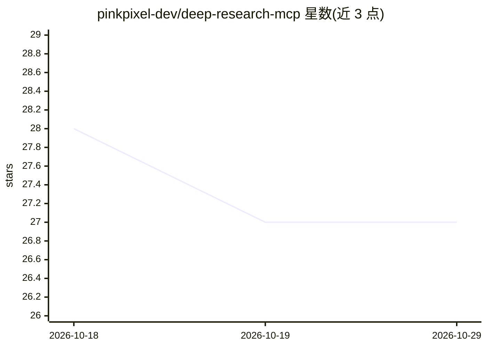

# pinkpixel-dev/deep-research-mcp

⭐ 27 · JavaScript · Apache-2.0 · 推送 2026-07-13 · [GitHub](https://github.com/pinkpixel-dev/deep-research-mcp) · [官网](https://pinkpixel.dev) · 组织维护

**MCP 深度网络调研服务器：供 AI agent 聚合搜索结果生成文档**

面向 MCP 生态的 Node.js 服务器，暴露 deep-research-tool 供 LLM/AI agent 调用：通过 Tavily Search 找相关来源，再用 Tavily Crawl 抓取各来源详细内容，连同查询、搜索摘要与文档生成指令聚合为结构化 JSON 返回，由调用方 LLM 生成 markdown 文档。必须配置 TAVILY_API_KEY；支持自定义文档提示词、输出路径、超时与爬取限制等参数；附带默认禁用的安全文件写入工具。

## 筛选速览

| 维度 | 判定 | 备注 |
|---|---|---|
| AI 角色 | `ai-ecosystem` | LLM/agent 周边工具 |
| 许可风险 | `permissive` | Apache-2.0 |
| 部署形态 | `library` | 以包/库形式分发 |
| 模型依赖 | — | README 未给出锁定关系 |
| 硬件要求 | — | 无带数字的原话,不猜 |
| 安装摩擦 | `low` | 无编译、无系统依赖或容器化 |
| 成熟度 | — | 结构信号不足 |

## 能力要点

- Tavily Search + Crawl 两步聚合，返回结构化 JSON 供 LLM 生成文档
- 文档提示词可经工具参数/环境变量覆盖
- 搜索深度、爬取深度/数量、超时等细粒度参数
- 带目录限制与行数上限的安全文件写入工具（默认禁用）

## 适用场景

- 让 MCP 客户端中的 AI agent 对指定主题做网络深度调研
- 自动汇总多来源网页内容并生成 markdown 研究文档
- 控制研究结果与图片的本地保存路径

## 场景标签

`科研工具` `网页抓取` · 领域:效率与自动化

## 证据(README 行号)

> L9: The Deep Research MCP Server is a Model Context Protocol (MCP) compliant server designed to perform comprehensive we
> L23: * **MCP Compliant:** Designed to integrate seamlessly into MCP-based AI agent ecosystems.
> L252: 1. An LLM or AI agent makes a `CallToolRequest` to this MCP server, specifying the `deep-research-tool` and provid

## 星数曲线

2026-10-18 28 → 2026-10-29 27（-1）

---
*卡片 v1 · prompt 1.4 · 生成 2026-10-26 · 置信度 high · 依据 README sha `879185ddd3f5` · [字段定义](../../DATASET.md)*
