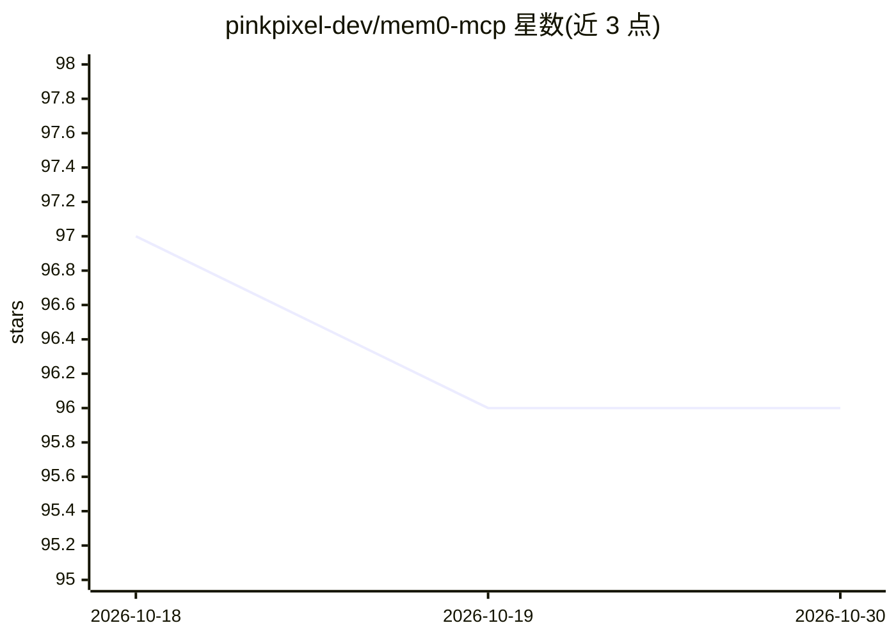

# pinkpixel-dev/mem0-mcp

⭐ 96 · TypeScript · MIT · 推送 2026-10-21 · [GitHub](https://github.com/pinkpixel-dev/mem0-mcp) · [官网](https://pinkpixel.dev) · 组织维护

**为 AI agent 提供跨会话长期记忆的 Mem0 MCP 服务器**

基于 mem0ai Node.js SDK 的 Model Context Protocol 服务器，让 Claude Desktop、Cursor、Cline 等 MCP 客户端中的 AI agent 通过 add_memory、search_memories（语义+BM25 混合检索）、批量更新/删除、历史审计等 15+ 工具存取持久记忆。支持三种存储模式：Mem0 云端（需 API key）、Supabase 自托管（需 SQL 迁移与 OpenAI embedding）、本地内存模式（重启丢数据，仅限开发测试）。提供 npm 全局安装、npx 与源码构建三种运行方式。

## 筛选速览

| 维度 | 判定 | 备注 |
|---|---|---|
| AI 角色 | `ai-ecosystem` | LLM/agent 周边工具 |
| 许可风险 | `permissive` | MIT |
| 部署形态 | `library` | 以包/库形式分发 |
| 模型依赖 | — | README 未给出锁定关系 |
| 硬件要求 | — | 无带数字的原话,不猜 |
| 安装摩擦 | `low` | 无编译、无系统依赖或容器化 |
| 成熟度 | — | 结构信号不足 |

## 能力要点

- 15+ 记忆工具：添加/混合检索/批量更新删除/审计历史/导出
- 三种存储模式：Mem0 云端、Supabase 自托管（pgvector）、本地内存
- userId/agentId/appId/sessionId 四级记忆作用域与环境变量回退机制
- Cloud V3 异步任务轮询与后台事件查询

## 适用场景

- 给 Claude Desktop 等 MCP 客户端接入跨会话记忆
- 自托管 Supabase 方案掌控记忆数据存储
- 为多 agent/多项目场景按 ID 作用域隔离记忆

## 场景标签

`Agent 记忆` · 领域:Agent 开发

## 证据(README 行号)

> L15: A Model Context Protocol (MCP) server that integrates with Mem0.ai to provide persistent memory capabilities for LL
> L17: This server uses the `mem0ai` Node.js SDK for its core functionality.

## 星数曲线

2026-10-18 97 → 2026-10-30 96（-1）

---
*卡片 v1 · prompt 1.4 · 生成 2026-10-23 · 置信度 high · 依据 README sha `d3258bd370e5` · [字段定义](../../DATASET.md)*
