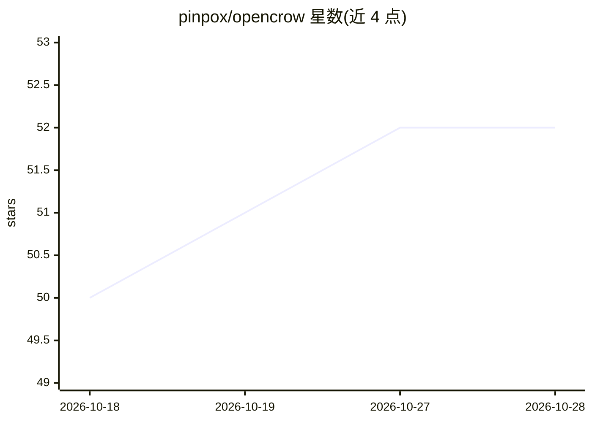

# pinpox/opencrow

⭐ 52 · Go · 推送 2026-10-22 · [GitHub](https://github.com/pinpox/opencrow) · 个人维护

**通过 Matrix/Nostr/Signal 聊天使用个人 AI 编码助手的桥接机器人**

用 Go 编写的消息机器人，将 Matrix、Nostr、Signal 三种聊天后端的消息转发给 omp（Oh My Pi）编码 agent，通过 RPC 协议以长驻子进程方式运行 omp 并回传回复，具备会话持久化、自动压缩与多 provider LLM 支持（由 omp 提供）。同一时刻仅一条活跃会话，会话数据跨重启保留。README 明确警告：无白名单、权限系统或工具过滤，需在 NixOS 容器或 VM 等隔离环境中运行，并附带实现隔离的 NixOS 模块。支持以 markdown 指令扩展技能与 TypeScript 生命周期钩子。

## 筛选速览

| 维度 | 判定 | 备注 |
|---|---|---|
| AI 角色 | `ai-native` | 本体是模型或模型工具 |
| 许可风险 | `none` | — |
| 部署形态 | `None` |  |
| 模型依赖 | — | README 未给出锁定关系 |
| 硬件要求 | — | 无带数字的原话,不猜 |
| 安装摩擦 | `low` | 无编译、无系统依赖或容器化 |
| 成熟度 | — | 结构信号不足 |

## 能力要点

- Matrix（E2EE）/Nostr（NIP-17）/Signal 三种消息后端
- 以 RPC 子进程方式桥接 omp 编码 agent，会话跨重启持久化
- 附带实现容器隔离的 NixOS 模块
- markdown 技能扩展与 TypeScript 生命周期钩子

## 适用场景

- 在加密聊天软件里随时调用个人 AI 编码助手
- 通过聊天安排周期检查与一次性提醒
- 在隔离环境中运行可执行命令的 agent 机器人

## 场景标签

`编码 Agent` `AI 助手` · 领域:编码与开发

## 证据(README 行号)

> L7: OpenCrow is a messaging bot that bridges chat messages to
> L11: long-lived subprocess via its RPC protocol and acts as a thin bridge. The bot

## 星数曲线

2026-10-18 50 → 2026-10-28 52（+2）

---
*卡片 v1 · prompt 1.4 · 生成 2026-10-24 · 置信度 high · 依据 README sha `7ba4f9dc76f1` · [字段定义](../../DATASET.md)*
