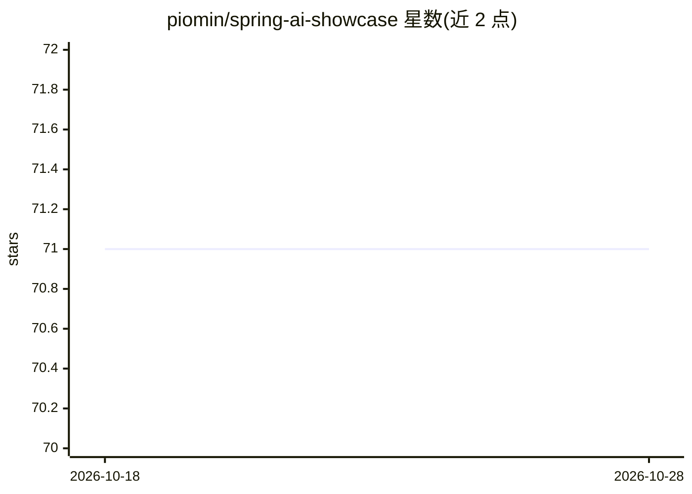

# piomin/spring-ai-showcase

⭐ 71 · Java · MIT · 推送 2026-10-27 · [GitHub](https://github.com/piomin/spring-ai-showcase) · [官网](https://piotrminkowski.com) · 个人维护

**Spring AI 框架示例应用：演示聊天、RAG、多模态等集成**

基于 Spring Boot 与 Spring AI 框架的演示项目，通过四个 REST 控制器展示 AI 能力集成：prompt 模板与聊天记忆（PersonController）、函数/工具调用结合股票价格计算钱包价值（WalletController）、基于 Pinecone 向量库与 OpenAI 的 RAG 股票分析（StockController）、图像模型与多模态（ImageController），另有动态实体生成 API。支持通过 Maven profile 切换 OpenAI、Mistral AI、Ollama、Azure OpenAI、Anthropic 等模型提供方，配套系列教程文章。需 Java/Maven 从源码构建运行。

## 筛选速览

| 维度 | 判定 | 备注 |
|---|---|---|
| AI 角色 | `ai-ecosystem` | LLM/agent 周边工具 |
| 许可风险 | `permissive` | MIT |
| 部署形态 | `None` |  |
| 模型依赖 | local-ok | 支持本地模型 |
| 硬件要求 | — | 无带数字的原话,不猜 |
| 安装摩擦 | `low` | 无编译、无系统依赖或容器化 |
| 成熟度 | — | 结构信号不足 |

## 能力要点

- 通过 Maven profile 切换 OpenAI/Mistral/Ollama/Azure/Anthropic 提供方
- 四个 REST 控制器分别演示聊天记忆、工具调用、RAG、图像多模态
- RAG 示例使用 Pinecone 向量库
- 提供多版本 RAG 实现端点（v1/v1.1/v2）

## 适用场景

- 学习如何在 Spring Boot 应用中集成 Spring AI
- 参考不同 AI 提供方之间的切换配置方式
- 复用 RAG、工具调用、多模态的示例代码

## 场景标签

`RAG` `教程课程` · 领域:知识与检索

## 证据(README 行号)

> L10: This project demonstrates the integration of AI capabilities within a Spring Boot application, utilizing the Spring
> L15: 1. Getting started with Spring AI **Chat Model** and easily switch between different AI providers including **OpenA

## 星数曲线

2026-10-18 71 → 2026-10-28 71（+0）

---
*卡片 v1 · prompt 1.4 · 生成 2026-10-24 · 置信度 high · 依据 README sha `ca8993b56bff` · [字段定义](../../DATASET.md)*
