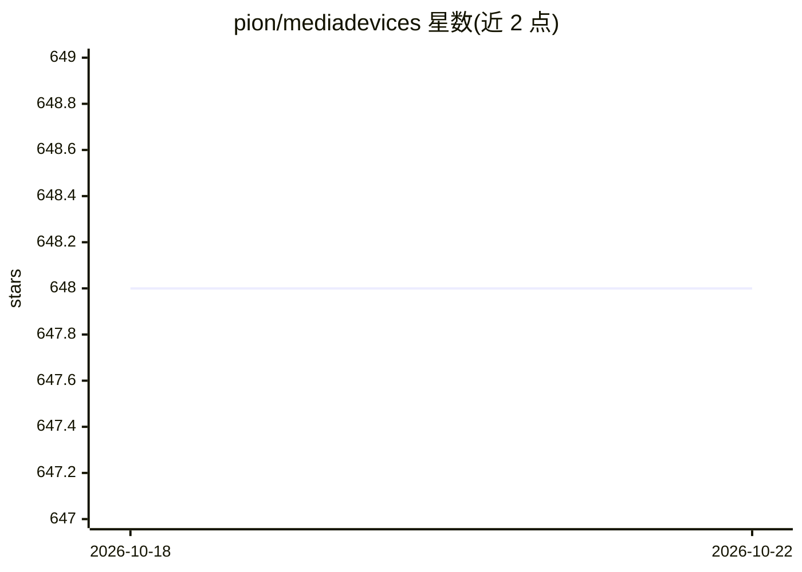

# pion/mediadevices

⭐ 648 · Go · MIT · 推送 2026-10-19 · [GitHub](https://github.com/pion/mediadevices) · [官网](https://pion.ly/) · 组织维护

**Go 的 MediaDevices API 实现：访问摄像头/麦克风/屏幕并编码**

Pion 生态的 Go 库，实现浏览器 MediaDevices API，提供对摄像头、麦克风、屏幕采集的统一访问，支持按需导入驱动包。编解码不内建实现，而是通过 cgo 调用系统编解码库（x264、openh264、svtav1、vpx、vaapi、mmal、opus），需先用包管理器安装对应库。覆盖 Linux/macOS/Windows 三平台输入，示例包括 WebRTC 视频通话、RTP 推流、HTTP 广播与人脸检测。

## 筛选速览

| 维度 | 判定 | 备注 |
|---|---|---|
| AI 角色 | `ai-ecosystem` | LLM/agent 周边工具 |
| 许可风险 | `permissive` | MIT |
| 部署形态 | `None` |  |
| 模型依赖 | — | README 未给出锁定关系 |
| 硬件要求 | — | 无带数字的原话,不猜 |
| 安装摩擦 | `low` | 无编译、无系统依赖或容器化 |
| 成熟度 | — | 结构信号不足 |

## 能力要点

- 摄像头/麦克风/屏幕采集，支持 Linux/macOS/Windows
- 驱动与编解码均按需导入，通过 cgo 调用系统编解码库
- 支持 x264/openh264/svtav1/vpx/vaapi/mmal/opus 多种编解码
- 提供 nomicrophone 构建标签便于交叉编译

## 适用场景

- 在 Go 程序中采集摄像头画面并保存为图片
- 构建 WebRTC 实时视频通话或 RTP 推流应用
- 树莓派上利用 mmal 硬件编码做 H264 视频流

## 场景标签

 · 领域:音视频/多媒体开发

## 证据(README 行号)

> L3:  Go implementation of the MediaDevices API
> L42: * Face Detection - Use a machine learning algorithm to detect faces in a camera stream

## 星数曲线

2026-10-18 648 → 2026-10-22 648（+0）

---
*卡片 v1 · prompt 1.4 · 生成 2026-10-21 · 置信度 mid · 依据 README sha `d7904ce8d6ca` · [字段定义](../../DATASET.md)*
