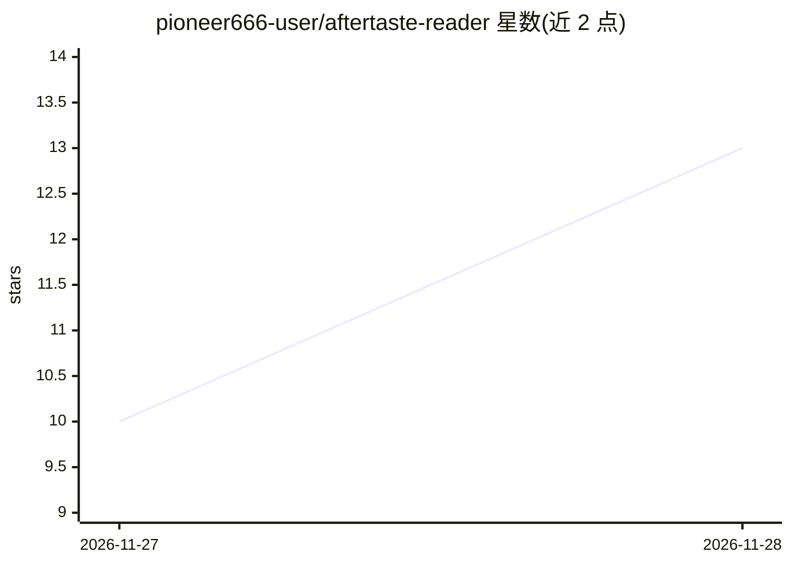

# pioneer666-user/aftertaste-reader

⭐ 13 · JavaScript · MIT · 推送 2026-11-26 · [GitHub](https://github.com/pioneer666-user/aftertaste-reader) · 个人维护 · 中文 README

**面向读源码的开发者：把 AI 讲解与固定提交源码对照阅读**

回味是一个本机源码阅读工具：以 npm 打包分发，安装后由已读取其 Skill 的 AI 宿主为 Git 项目生成讲解与「闭环」路线图，阅读服务在本机运行，浏览器通过私密入口打开页面，将 AI 讲解、判断流程与固定 HEAD 提交中的源码逐行对照展示。依赖 Node.js 24 LTS、npm、Git 与一个能读取本机文件并运行终端命令的 AI 宿主；讲解生成本身依赖用户选择的 AI 及其设置，项目自身不含模型。

## 筛选速览

| 维度 | 判定 | 备注 |
|---|---|---|
| AI 角色 | `ai-native` | 本体是模型或模型工具 |
| 许可风险 | `permissive` | MIT |
| 部署形态 | `None` |  |
| 模型依赖 | — | README 未给出锁定关系 |
| 硬件要求 | — | 无带数字的原话,不猜 |
| 安装摩擦 | `low` | 无编译、无系统依赖或容器化 |
| 成熟度 | `idea` | |

## 能力要点

- 讲解、闭环与阅读记录保存在所读项目目录内，服务本机运行
- 默认固定开始时的 HEAD 提交，可指定本地 Git 提交阅读其他版本
- 断网时页面、字体与已有讲解由本机提供，源码从 Git 提交读取
- 通过私密入口访问，服务停止后链接失效

## 适用场景

- 顺着一次请求读懂真实开源项目的数据流转
- 按闭环路线从已有讲解对照源码逐段阅读
- 离线回顾此前生成的讲解与阅读记录

## 场景标签

`代码审查` · 领域:编码与开发

## 证据(README 行号)

> L3: 会写基本功能，想读懂真实项目？用回味把 AI 讲解和 Git 固定提交的源码放在一起，顺着一次请求看清数据怎样传递、何时写入、最后返回什么。
> L40: 阅读服务在本机运行，讲解、闭环和个人阅读记录保存在所读项目里。生成讲解时，源码如何交给模型处理取决于你选择的 AI 宿主及其设置。

## 星数曲线

2026-11-27 10 → 2026-11-28 13（+3）

---
*卡片 v1 · prompt 1.4 · 生成 2026-11-27 · 置信度 mid · 依据 README sha `c990d16d80ea` · [字段定义](../../DATASET.md)*
