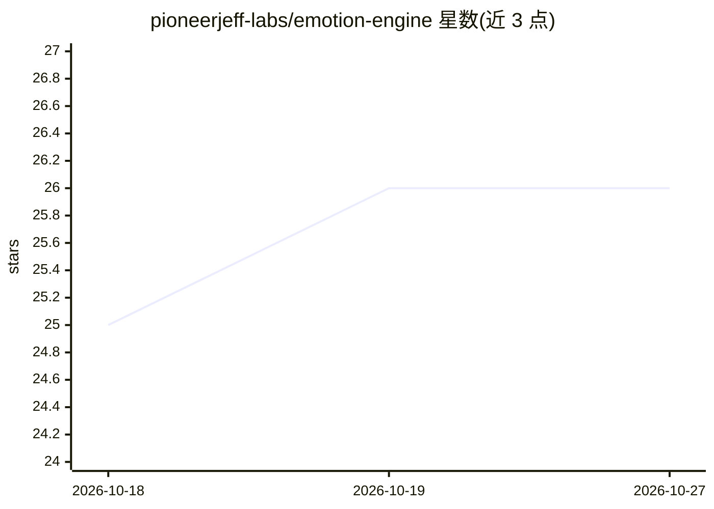

# pioneerjeff-labs/emotion-engine

⭐ 26 · Python · MIT · 推送 2026-08-29 · [GitHub](https://github.com/pioneerjeff-labs/emotion-engine) · [官网](https://pioneerjeff-labs.github.io/emotion-engine/) · 组织维护 · 中文 README

**给 LLM Agent 的情绪连续性状态层（PAD/信任/衰减）**

为长程运行的 LLM Agent 提供可检视的情感连续性状态层：持久化 PAD 情绪状态、Agent 对用户信任、衰减、边界信号与紧凑情绪日志，并把状态以 prompt prelude 形式注入后续对话；情境判断与回复仍由 LLM 决定，本引擎负责持久化与状态更新。核心是 Python 状态引擎与 stdio MCP server，另提供 OpenClaw、Claude Skill、Hermes、Codex、Pi Agent 等集成包与无 API key 的最小示例。明确声明不替代记忆栈，不适用于心理健康评估等场景。

## 筛选速览

| 维度 | 判定 | 备注 |
|---|---|---|
| AI 角色 | `ai-ecosystem` | LLM/agent 周边工具 |
| 许可风险 | `permissive` | MIT |
| 部署形态 | `None` |  |
| 模型依赖 | — | README 未给出锁定关系 |
| 硬件要求 | — | 无带数字的原话,不猜 |
| 安装摩擦 | `low` | 无编译、无系统依赖或容器化 |
| 成熟度 | `idea` | |

## 能力要点

- PAD 状态、信任分层、衰减与紧凑情绪日志的持久化状态层
- 提供 prompt prelude 注入与机器可读 schema（emotion-state.schema.json）
- OpenClaw/Claude Skill/Hermes/Codex/Pi Agent 一方集成包与本地 stdio MCP server
- 示例与本地检查脚本无需 API key 与 LLM 调用

## 适用场景

- 让角色 Agent 或 AI 伴侣跨会话保持情绪一致
- 个人助手记录上次互动是协作还是紧张的关系状态
- 游戏 NPC 的情绪随时间演化的原型开发

## 场景标签

`Agent 记忆` · 领域:Agent 开发

## 证据(README 行号)

> L14: Emotion Engine gives an LLM-powered agent a small, inspectable continuity layer: mood, agent-to-user trust, decay, 
> L72: - The **Python helper** persists state, applies decay, records logs, extracts session patterns, and updates trust s
> L75: In short: **the LLM decides; Emotion Engine remembers.**

## 星数曲线

2026-10-18 25 → 2026-10-27 26（+1）

---
*卡片 v1 · prompt 1.4 · 生成 2026-10-26 · 置信度 high · 依据 README sha `a35afbf464aa` · [字段定义](../../DATASET.md)*
