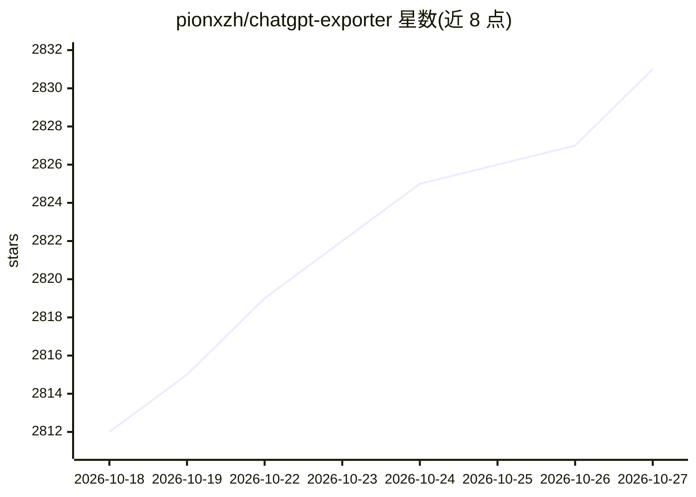

# pionxzh/chatgpt-exporter

⭐ 2,831 · TypeScript · MIT · 推送 2026-10-17 · [GitHub](https://github.com/pionxzh/chatgpt-exporter) · 个人维护

**导出 ChatGPT 对话记录的浏览器用户脚本**

以 Tampermonkey 用户脚本形式安装在浏览器中的 GreasyFork 工具：在 ChatGPT 页面侧边栏提供菜单，将对话历史导出为文本复制、PNG 截图、Markdown、HTML 及 JSON（含 OpenAI 官方格式与 TavernAI/SillyTavern、Ooba 格式），支持一次性批量导出多段对话。面向需要保存或迁移 ChatGPT 对话的普通用户，安装需先装 Tampermonkey（Chrome/Firefox/Edge），并开启浏览器的 Allow User Scripts 设置。另有姐妹项目 DeepSeek Exporter。

## 筛选速览

| 维度 | 判定 | 备注 |
|---|---|---|
| AI 角色 | `ai-ecosystem` | LLM/agent 周边工具 |
| 许可风险 | `permissive` | MIT |
| 部署形态 | `None` |  |
| 模型依赖 | — | README 未给出锁定关系 |
| 硬件要求 | — | 无带数字的原话,不猜 |
| 安装摩擦 | `low` | 无编译、无系统依赖或容器化 |
| 成熟度 | — | 结构信号不足 |

## 能力要点

- 五种导出格式：文本、PNG、Markdown、HTML、JSON（OpenAI 官方/TavernAI/SillyTavern/Ooba）
- Export All 批量导出多段对话
- 通过 GreasyFork 或 GitHub 一键安装用户脚本

## 适用场景

- 把 ChatGPT 对话保存为 Markdown 或 HTML 留档
- 将对话导出为 JSON 供 TavernAI/SillyTavern 等工具使用
- 批量导出全部对话记录做备份

## 场景标签

 · 领域:AI 对话工具/浏览器用户脚本

## 证据(README 行号)

> L3: ## A GreasyFork script to export the chat history of ChatGPT
> L33: - Copy as text

## 星数曲线

2026-10-18 2,812 → 2026-10-27 2,831（+19）

---
*卡片 v1 · prompt 1.4 · 生成 2026-10-21 · 置信度 high · 依据 README sha `672fad49cfab` · [字段定义](../../DATASET.md)*
