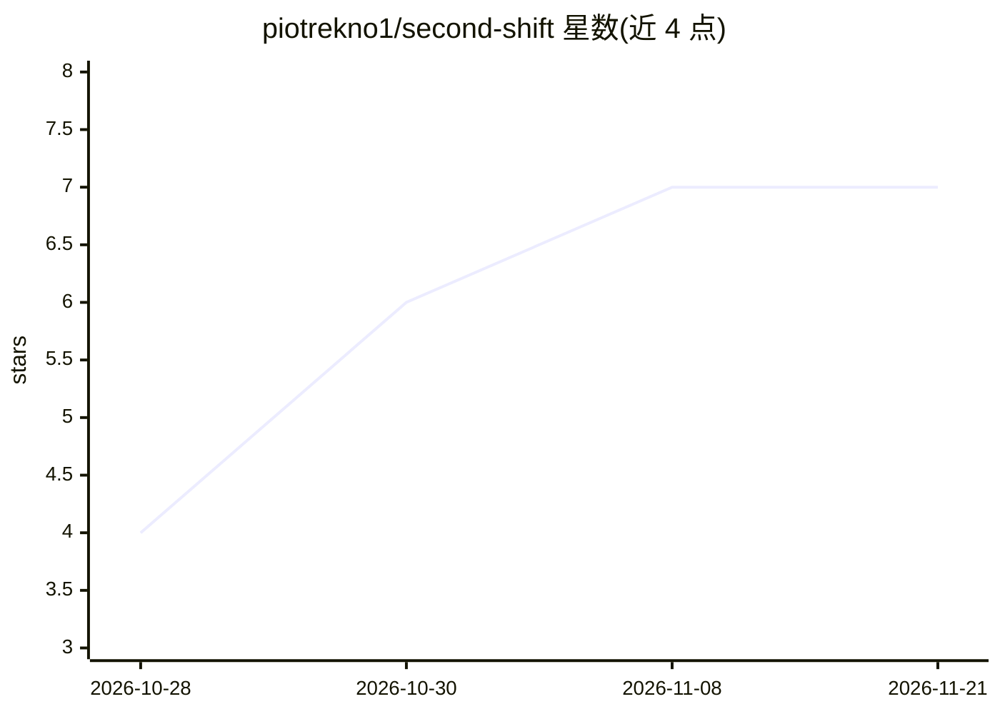

# piotrekno1/second-shift

⭐ 7 · Python · Apache-2.0 · 推送 2026-11-20 · [GitHub](https://github.com/piotrekno1/second-shift) · [官网](https://second-shift.app/) · 个人维护

**给平台/安全/SRE 团队的 Git 中定义无人值守 agent 任务系统**

SecondShift 让团队在仓库中以 skill 加 YAML 定义 agent 任务，按计划、webhook 事件或手动/MCP 触发运行，结果输出到 Slack、GitHub issue 或草稿 PR。安全机制是核心：agent 在无网络、无凭证的沙箱中运行，每次工具调用经 broker 对照 owner 批准的清单检查，模型密钥隔离在网关侧；每次运行记录 commit、工具调用与 token 开销，并有预算上限。部署用 uv 与 Docker，beta 状态。

## 筛选速览

| 维度 | 判定 | 备注 |
|---|---|---|
| AI 角色 | `ai-ecosystem` | LLM/agent 周边工具 |
| 许可风险 | `permissive` | Apache-2.0 |
| 部署形态 | `self-host` | docker 或自建部署 |
| 模型依赖 | — | README 未给出锁定关系 |
| 硬件要求 | — | 无带数字的原话,不猜 |
| 安装摩擦 | `low` | 无编译、无系统依赖或容器化 |
| 成熟度 | `idea` | |

## 能力要点

- Git 中定义任务：skill 为 Markdown，配置为 .secondshift.yaml，经 PR 审批
- agent 沙箱无网络无凭证，工具调用经 broker 逐项校验批准计划
- 三种触发方式：计划调度、签名 webhook、面板/编码 agent 一次性任务
- 作为 MCP server 与 Claude Code、Codex、Cursor 等客户端协作

## 适用场景

- CI 失败分类、文档漂移检查等周期性开发任务自动化
- 告警到达时自动分诊并通知到 Slack
- 安全回归与季度访问审查等合规类周期任务
- 从编码 agent 提交任务并读取运行报告

## 场景标签

`工作流自动化` `Agent 框架` `网络安全` · 领域:Agent 开发

## 证据(README 行号)

> L9: and no service credentials. Every tool call goes through a broker that checks
> L164: **Works with your coding agent.** SecondShift is an MCP server. Claude Code,

## 星数曲线

2026-10-28 4 → 2026-11-21 7（+3）

---
*卡片 v1 · prompt 1.4 · 生成 2026-11-20 · 置信度 high · 依据 README sha `a035bc586720` · [字段定义](../../DATASET.md)*
