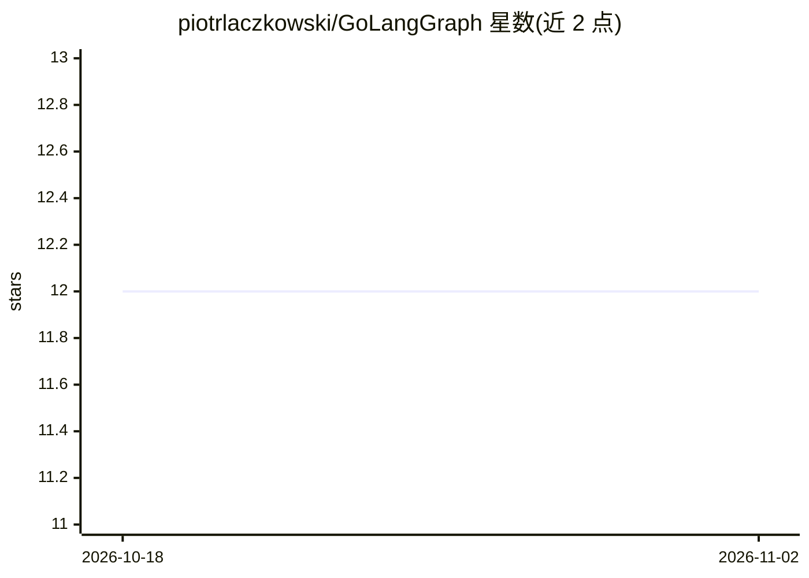

# piotrlaczkowski/GoLangGraph

⭐ 12 · Go · MIT · 推送 2026-08-07 · [GitHub](https://github.com/piotrlaczkowski/GoLangGraph) · [官网](https://piotrlaczkowski.github.io/GoLangGraph/) · 个人维护

**Go 语言版 LangGraph：以图执行构建 AI agent 工作流**

用 Go 实现的 LangGraph 风格框架：以有向图组织节点与边来构建 agent 工作流，提供 Chat、ReAct、Tool 三类 agent 实现，内置计算器、网页搜索、文件操作、Shell 等工具。支持 OpenAI、Ollama、Gemini 三种 LLM 提供商接入。Auto Server 可为 agent 自动生成 REST API、Web 聊天界面与 /playground 端点，并支持 Prometheus 指标与 Grafana 监控。MIT 许可，GUI Studio 组件为开发中状态。面向用 Go 构建 AI 应用与多 agent 工作流的开发者。

## 筛选速览

| 维度 | 判定 | 备注 |
|---|---|---|
| AI 角色 | `ai-ecosystem` | LLM/agent 周边工具 |
| 许可风险 | `permissive` | MIT |
| 部署形态 | `None` |  |
| 模型依赖 | local-ok | 支持本地模型 |
| 硬件要求 | — | 无带数字的原话,不猜 |
| 安装摩擦 | `low` | 无编译、无系统依赖或容器化 |
| 成熟度 | — | 结构信号不足 |

## 能力要点

- 图执行引擎构建节点/边工作流，含 Chat/ReAct/Tool 三类 agent
- OpenAI、Ollama、Gemini 提供商集成
- Auto Server 自动生成 REST API、Web UI 与 playground
- Prometheus 指标、Grafana 仪表盘与 Docker 支持

## 适用场景

- 用 Go 构建带工具调用的 ReAct agent
- 搭建 RAG 或多 agent 协作工作流
- 配合本地 Ollama 做离线 LLM 应用开发与测试
- 将 agent 快速暴露为 REST 服务并接入监控

## 场景标签

`Agent 框架` · 领域:Agent 开发

## 证据(README 行号)

> L19: **GoLangGraph** is a Go framework for building AI agent workflows using graph-based execution. Create intelligent a
> L31: - 🧠 **AI Agent Framework** - Chat, ReAct, and Tool agents with different capabilities

## 星数曲线

2026-10-18 12 → 2026-11-02 12（+0）

---
*卡片 v1 · prompt 1.4 · 生成 2026-11-01 · 置信度 high · 依据 README sha `3377cf627560` · [字段定义](../../DATASET.md)*
