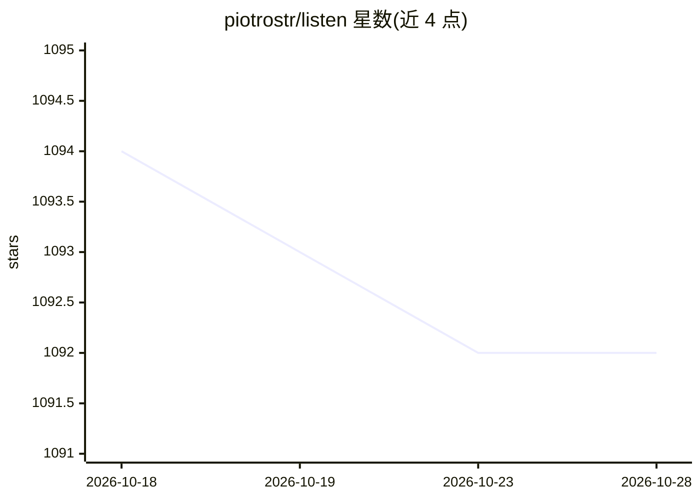

# piotrostr/listen

⭐ 1,092 · TypeScript · AGPL-3.0 · 推送 2025-11-05 · [GitHub](https://github.com/piotrostr/listen) · [官网](https://listen-rs.com) · 个人维护

**Solana 链上交易工具框架：供 AI 代理执行跨链组合管理**

Rust 编写的 Solana 算法交易工具集，功能包括实时交易监控、多 DEX 换币（Pump.fun/Jupiter V6/Raydium）、基于 Jito MEV bundle 的交易发送、价格跟踪、代币管理与 Prometheus 指标。通过 rig 框架以即插即用方式让 AI 代理与 Solana 区块链交互（Rig Agent Kit），驱动 Listen App。以 docker compose 启动仪表盘，或 cargo 源码运行；需 Rust nightly、protoc 等系统依赖。README 声明处于快速迭代期，可能存在破坏性变更。

## 筛选速览

| 维度 | 判定 | 备注 |
|---|---|---|
| AI 角色 | `ai-ecosystem` | LLM/agent 周边工具 |
| 许可风险 | `viral` | AGPL-3.0 |
| 部署形态 | `self-host` | docker 或自建部署 |
| 模型依赖 | — | README 未给出锁定关系 |
| 硬件要求 | — | 无带数字的原话,不猜 |
| 安装摩擦 | `low` | 无编译、无系统依赖或容器化 |
| 成熟度 | `idea` | |

## 能力要点

- 实时交易监控与多 DEX 换币执行（Pump.fun/Jupiter V6/Raydium）
- 基于 Jito MEV bundle 的交易发送
- 通过 rig 框架即插即用接入 AI 代理操作 Solana 链
- 内置 Prometheus 指标与 docker compose 仪表盘

## 适用场景

- 搭建 Solana 链上的算法交易与监控程序
- 让 AI 代理执行链上换币与组合管理
- 通过本地仪表盘跟踪交易与价格指标

## 场景标签

`金融量化` · 领域:学习与行业

## 证据(README 行号)

> L3: <code>listen</code> started sa Solana Swiss-Knife toolkit for algorithmic trading, its mission has become the go-to 
> L27: It works plug'n'play with [$arc rig
> L28: framework](https://github.com/0xPlaygrounds/rig) framework allowing AI Agents

## 星数曲线

2026-10-18 1,094 → 2026-10-28 1,092（-2）

---
*卡片 v1 · prompt 1.4 · 生成 2026-10-21 · 置信度 high · 依据 README sha `5c956b520abe` · [字段定义](../../DATASET.md)*
