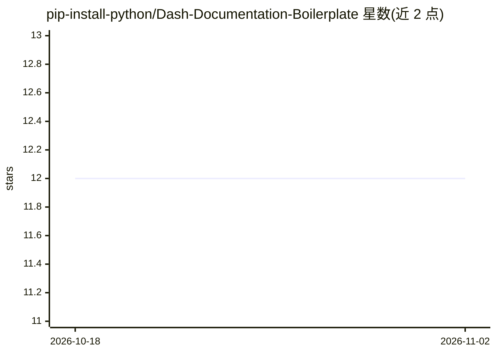

# pip-install-python/Dash-Documentation-Boilerplate

⭐ 12 · Python · MIT · 推送 2026-09-12 · [GitHub](https://github.com/pip-install-python/Dash-Documentation-Boilerplate) · [官网](https://boilerplate.2plot.dev) · 组织维护

**面向 Dash 组件的 Markdown 驱动文档站点模板，含 LLM 友好输出**

2plot 网络的文档站点模板：用 Markdown 加 frontmatter 生成 Dash 组件/数据科学工作流文档，提供交互式示例（exec/source/kwargs/toc 指令）、明暗主题持久化、四级页面访问控制与可选 Clerk 认证、可在 Flask/FastAPI/Quart 间切换的后端，及 Docker/Gunicorn/Uvicorn 部署支持。AI 相关功能包括每页 /llms.txt 原文输出、MCP 资源注册（Dash 4.3+）、训练爬虫拦截与 sitemap/SEO 管理。需 Python 3.12+ 与 Node.js/npm，markdown2dash 须以 --no-deps 方式单独安装。

## 筛选速览

| 维度 | 判定 | 备注 |
|---|---|---|
| AI 角色 | `ai-enhanced` | 去掉 AI 部分产品仍成立 |
| 许可风险 | `permissive` | MIT |
| 部署形态 | `self-host` | docker 或自建部署 |
| 模型依赖 | — | README 未给出锁定关系 |
| 硬件要求 | — | 无带数字的原话,不猜 |
| 安装摩擦 | `low` | 无编译、无系统依赖或容器化 |
| 成熟度 | — | 结构信号不足 |

## 能力要点

- Markdown + frontmatter 自动生成文档页与目录
- 每页 /<page>/llms.txt 输出与 dash.mcp 资源注册（Dash 4.3+）
- 同一应用通过 DASH_BACKEND 在 Flask/FastAPI/Quart 间切换
- 四级页面访问控制与 admin 控制板在线调整页面层级

## 适用场景

- 为 Dash 组件或数据科学应用搭建文档站
- 让自己的文档可被 ChatGPT/Claude 等 AI 直接抓取引用
- fork 模板快速获得带认证与主题管理的文档站点

## 场景标签

 · 领域:Web 开发/文档工具

## 证据(README 行号)

> L17: A comprehensive boilerplate for creating beautiful, interactive documentation for your Dash components, data scienc
> L64: - **`LLMS_DOC` pattern** — write a module-level prose string per page; served verbatim at `/<page>/llms.txt`

## 星数曲线

2026-10-18 12 → 2026-11-02 12（+0）

---
*卡片 v1 · prompt 1.4 · 生成 2026-11-01 · 置信度 high · 依据 README sha `a8756079c9d5` · [字段定义](../../DATASET.md)*
