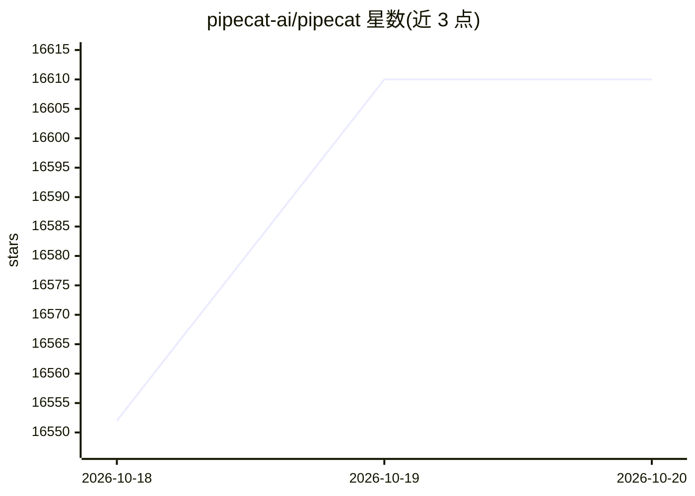

# pipecat-ai/pipecat

⭐ 16,610 · Python · BSD-2-Clause · 推送 2026-10-19 · [GitHub](https://github.com/pipecat-ai/pipecat) · [官网](https://pipecat.ai) · 组织维护

**构建实时语音与多模态 AI 对话代理的 Python 框架**

开源 Python 框架，用于搭建实时语音与多模态对话代理：可编排语音识别、文本转语音、LLM、音视频传输与对话管线，支持单个语音代理或多代理系统（专家交接、并行扇出、共享总线，可跨进程跨机器分布式部署）。集成数十家 AI 服务商，提供 CLI 脚手架（pipecat init）、客户端 SDK（JS/React/Swift/Kotlin 等）与 Pipecat UI 组件库。默认仅含核心框架，第三方服务按 extras 安装；需 Python 3.11+，推荐配合 uv 使用。

## 筛选速览

| 维度 | 判定 | 备注 |
|---|---|---|
| AI 角色 | `ai-ecosystem` | LLM/agent 周边工具 |
| 许可风险 | `permissive` | BSD-2-Clause |
| 部署形态 | `library` | 以包/库形式分发 |
| 模型依赖 | local-ok | 支持本地模型 |
| 硬件要求 | — | 无带数字的原话,不猜 |
| 安装摩擦 | `low` | 无编译、无系统依赖或容器化 |
| 成熟度 | — | 结构信号不足 |

## 动量与使用信号

- 维护:`active` — 距上次 push 0.7 天,年发版 33,339 位贡献者
- 涨星:近 1 天 **+30**(自 20261016 起算)
- 安装:pypi 包 `pipecat-ai` 月下载 1,043,553
- 平台:ANDROID / IOS · 协议:OLLAMA

## 能力要点

- 语音优先管线：集成 STT、TTS 与对话处理
- 多代理编排：交接、并行扇出、sidecar、分布式部署
- 服务表覆盖数十家 STT/LLM/TTS/S2S/传输等服务商
- CLI 脚手架可在约一分钟内生成可运行 bot

## 适用场景

- 搭建客服或电话语音机器人
- 构建多专家协作的多代理语音系统
- 做带语音视频输入的多模odal 对话应用

## 场景标签

`语音 Agent` `Agent 框架` `多智能体` `多模态` · 领域:Agent 开发

## 证据(README 行号)

> L7: **Pipecat** is an open-source Python framework for building real-time voice and multimodal conversational agents. Bu
> L23: - **Voice-first**: Integrates speech recognition, text-to-speech, and conversation handling
> L26: - **Multi-Agent Ready**: Each pipeline is an agent. Compose them with handoff, parallel fan-out, sidecar workers, o

## 星数曲线

2026-10-18 16,552 → 2026-10-20 16,610（+58）

---
*卡片 v1 · prompt 1.4 · 生成 2026-10-20 · 置信度 high · 依据 README sha `b628b36cd136` · [字段定义](../../DATASET.md)*
