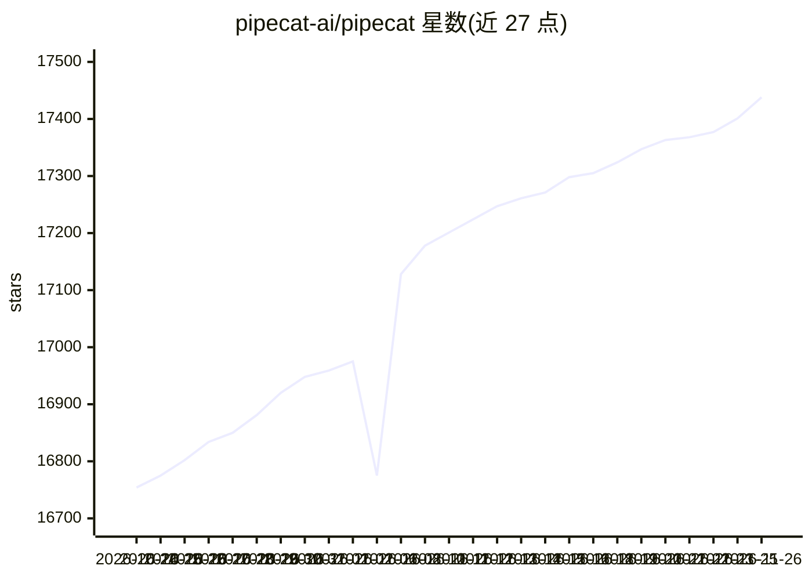

# pipecat-ai/pipecat

⭐ 17,438 · Python · BSD-2-Clause · 推送 2026-11-25 · [GitHub](https://github.com/pipecat-ai/pipecat) · [官网](https://pipecat.ai) · 组织维护

**构建实时语音与多模态 AI 代理的 Python 框架**

开源 Python 框架，用于构建实时语音与多模态对话代理，支持单代理或多代理系统（handoff、并行 fan-out、共享总线、跨进程分布式部署），编排音频视频、AI 服务、传输层与对话管道。提供 JavaScript/React/Swift/Kotlin/C++/ESP32 客户端 SDK、内建 Pipecat Flows 结构化对话、CLI 脚手架与部署工具，支持 WebSocket/WebRTC 传输。由 Daily 与社区维护。

## 筛选速览

| 维度 | 判定 | 备注 |
|---|---|---|
| AI 角色 | `ai-ecosystem` | LLM/agent 周边工具 |
| 许可风险 | `permissive` | BSD-2-Clause |
| 部署形态 | `library` | 以包/库形式分发 |
| 模型依赖 | local-ok | 支持本地模型 |
| 硬件要求 | — | 无带数字的原话,不猜 |
| 安装摩擦 | `low` | 无编译、无系统依赖或容器化 |
| 成熟度 | — | 结构信号不足 |

## 动量与使用信号

- 维护:`active` — 距上次 push 0.7 天,年发版 33,339 位贡献者
- 涨星:近 1 天 **+30**(自 20261016 起算)
- 安装:pypi 包 `pipecat-ai` 月下载 1,043,553
- 平台:ANDROID / IOS · 协议:OLLAMA

## 能力要点

- 语音优先：集成语音识别、文本转语音与对话处理
- 多代理就绪：每条管道即一个代理，支持 handoff/并行/分布式
- 可插拔：接入大量语音、LLM、视觉等第三方服务
- 官方多平台客户端 SDK（JS/React/Swift/Kotlin/C++/ESP32）

## 适用场景

- 构建支持电话呼入呼出的语音代理
- 搭建多代理协作的实时对话系统
- 开发语音+视频+图像的多模态交互应用
- 构建客服、陪聊、会议助手类业务代理

## 场景标签

`语音 Agent` `多模态` `Agent 框架` · 领域:Agent 开发

## 证据(README 行号)

> L7: **Pipecat** is an open-source Python framework for building real-time voice and multimodal conversational agents. Bu
> L24: - **Pluggable**: Supports many AI services and tools
> L26: - **Multi-Agent Ready**: Each pipeline is an agent. Compose them with handoff, parallel fan-out, sidecar workers, o

## 星数曲线

2026-10-24 16,754 → 2026-11-26 17,438（+684）

---
*卡片 v1 · prompt 1.4 · 生成 2026-11-22 · 置信度 high · 依据 README sha `1467ea6f5fbe` · [字段定义](../../DATASET.md)*
