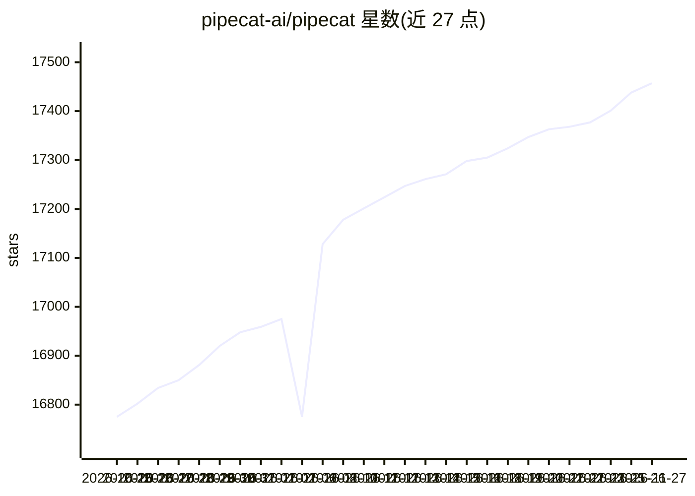

# pipecat-ai/pipecat

⭐ 17,457 · Python · BSD-2-Clause · 推送 2026-11-26 · [GitHub](https://github.com/pipecat-ai/pipecat) · [官网](https://pipecat.ai) · 组织维护

**给开发者的实时语音与多模态 AI Agent 构建框架**

开源 Python 框架，用于构建实时语音和多模态对话 Agent，可组成单 Agent 或多 Agent 系统（handoff、并行 fan-out、共享总线、跨进程/机器分布式部署）。框架编排音频/视频、AI 服务、传输层（WebRTC/WebSocket）与对话管线。提供多平台客户端 SDK（JS/React/Swift/Kotlin/C++/ESP32）、内置 Pipecat Flows 结构化对话、CLI 脚手架与部署工具、Pipecat Cloud 部署。支持 Python 3.11–3.14；部分 extras（local、gstreamer）需要系统依赖。

## 筛选速览

| 维度 | 判定 | 备注 |
|---|---|---|
| AI 角色 | `ai-ecosystem` | LLM/agent 周边工具 |
| 许可风险 | `permissive` | BSD-2-Clause |
| 部署形态 | `library` | 以包/库形式分发 |
| 模型依赖 | — | README 未给出锁定关系 |
| 硬件要求 | — | 无带数字的原话,不猜 |
| 安装摩擦 | `low` | 无编译、无系统依赖或容器化 |
| 成熟度 | — | 结构信号不足 |

## 动量与使用信号

- 维护:`active` — 距上次 push 0.7 天,年发版 33,339 位贡献者
- 涨星:近 1 天 **+30**(自 20261016 起算)
- 安装:pypi 包 `pipecat-ai` 月下载 1,043,553
- 平台:ANDROID / IOS · 协议:OLLAMA

## 能力要点

- 多 Agent 编排：handoff、并行 fan-out、sidecar 与分布式部署
- 集成 30+ 家语音识别/LLM/语音合成/语音到语音服务
- 多平台客户端 SDK：JavaScript、React、Swift、Kotlin、C++、ESP32
- CLI 脚手架一键生成可运行 bot 并部署到 Pipecat Cloud

## 适用场景

- 构建电话客服与外呼语音 Agent（Twilio、Plivo 等）
- 开发语音助手与 AI 陪伴类实时对话应用
- 搭建多 Agent 协作的复杂对话系统
- 用 Pipecat Flows 以 YAML 定义分步业务流程

## 场景标签

`语音 Agent` `Agent 框架` `多智能体` · 领域:Agent 开发

## 证据(README 行号)

> L7: **Pipecat** is an open-source Python framework for building real-time voice and multimodal conversational agents. Bu
> L87: ## 🧩 Available services

## 星数曲线

2026-10-25 16,775 → 2026-11-27 17,457（+682）

---
*卡片 v1 · prompt 1.4 · 生成 2026-11-26 · 置信度 mid · 依据 README sha `b972cfab823d` · [字段定义](../../DATASET.md)*
