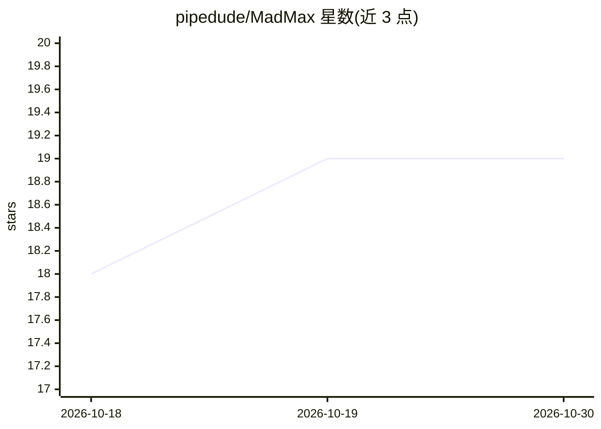

# pipedude/MadMax

⭐ 19 · Python · 推送 2026-06-13 · [GitHub](https://github.com/pipedude/MadMax) · 个人维护

**面向设备的实时语音 agent，带本地唤醒词与长期记忆**

基于 Google Gemini Live API 的 Python 实时语音助手：本地 Vosk 唤醒词检测后进入 Speech-to-Speech 实时对话，支持 Google Search 联网接地与工具调用。会话后自动抽取人物、地点、事实、目标、经验、反思等写入 JSON 文件长期记忆，通过 LLM Surgeon 做 UPDATE/MERGE/APPEND 冲突消解，写前备份、出错回滚。需 Linux、Python 3.11+、麦克风与 Google AI Studio API Key；路线图含 ROS2 机器人控制与记忆清理。

## 筛选速览

| 维度 | 判定 | 备注 |
|---|---|---|
| AI 角色 | `ai-native` | 本体是模型或模型工具 |
| 许可风险 | `none` | — |
| 部署形态 | `None` |  |
| 模型依赖 | — | README 未给出锁定关系 |
| 硬件要求 | — | 无带数字的原话,不猜 |
| 安装摩擦 | `low` | 无编译、无系统依赖或容器化 |
| 成熟度 | — | 结构信号不足 |

## 能力要点

- Vosk 本地唤醒词 + Gemini Live API 实时语音对话
- JSON 文件长期记忆：人物/地点/事实/目标/经验/反思自动抽取
- LLM Surgeon 记忆冲突消解与事务性备份回滚
- Google Search 联网接地与 live 模式工具调用

## 适用场景

- 在设备上搭建有长期记忆的实时语音助手
- 对话中联网查询新鲜信息并调用记忆检索工具
- 希望离线待机零 LLM 成本的常驻语音 agent

## 场景标签

`语音 Agent` `Agent 记忆` · 领域:Agent 开发

## 证据(README 行号)

> L3: A voice agent for devices, powered by **Google Gemini Live API** with a local wake-word detector and long-term memor
> L6: - 🗣️ Realtime Speech-to-Speech dialogue via Gemini Live API

## 星数曲线

2026-10-18 18 → 2026-10-30 19（+1）

---
*卡片 v1 · prompt 1.4 · 生成 2026-10-29 · 置信度 high · 依据 README sha `ffea9e290abf` · [字段定义](../../DATASET.md)*
