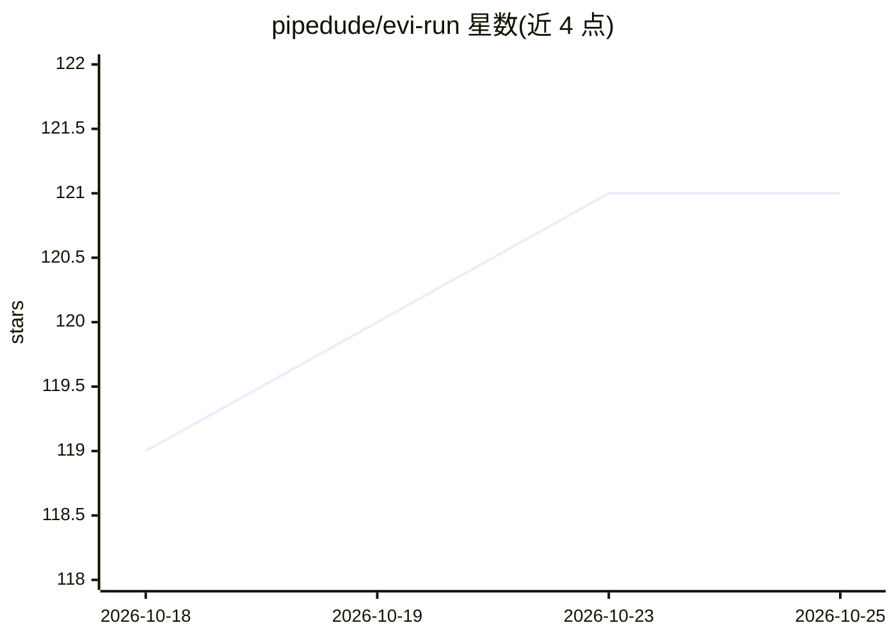

# pipedude/evi-run

⭐ 121 · Python · MIT · 推送 2026-03-29 · [GitHub](https://github.com/pipedude/evi-run) · 个人维护

**通过 Telegram 交付的多智能体 AI 系统，开箱即用可定制**

基于 Python 3.11 与 OpenAI Agents SDK 构建的多智能体系统，以 Telegram bot 为用户界面。功能含记忆管理、动态知识库、任务调度、多智能体编排、深度研究、网页搜索、文档处理、图像生成、DEX 监控与 Solana 代币交换。支持 private/free/pay 三种使用模式（pay 模式需销毁 $EVI 代币）。通过 Docker Compose 部署，依赖 PostgreSQL 与 Redis；非 OpenAI 模型经 LiteLLM 接入；含使用量追踪与 20+ 分析平台集成。限制：需 OpenAI/Telegram API key，Ubuntu 22.04 服务器。

## 筛选速览

| 维度 | 判定 | 备注 |
|---|---|---|
| AI 角色 | `ai-native` | 本体是模型或模型工具 |
| 许可风险 | `permissive` | MIT |
| 部署形态 | `self-host` | docker 或自建部署 |
| 模型依赖 | — | README 未给出锁定关系 |
| 硬件要求 | — | 无带数字的原话,不猜 |
| 安装摩擦 | `low` | 无编译、无系统依赖或容器化 |
| 成熟度 | — | 结构信号不足 |

## 能力要点

- 基于 OpenAI Agents SDK 的多智能体架构，专用 agent 以工具形式挂载到主 agent
- 经 LiteLLM 支持非 OpenAI 模型，可按 agent 混用不同提供商
- private/free/pay 三种使用模式，pay 模式含余额管理与 $EVI 代币销毁机制
- 自动追踪 agent 运行、LLM 调用、工具调用，支持 20+ 外部分析平台

## 适用场景

- 搭建自己的 Telegram AI 助手做研究、日常任务与数据处理
- 部署面向社区的客服或虚拟角色 bot
- 运行带实时分析的 DEX 交易 agent

## 场景标签

`多智能体` `AI 助手` · 领域:Agent 开发

## 证据(README 行号)

> L21: **evi-run** is a powerful, production-ready multi-agent AI system that bridges the gap between out-of-the-box solut
> L37: - **Multi-Agent Orchestration** - Complex task decomposition and execution

## 星数曲线

2026-10-18 119 → 2026-10-25 121（+2）

---
*卡片 v1 · prompt 1.4 · 生成 2026-10-23 · 置信度 mid · 依据 README sha `e28dc092d354` · [字段定义](../../DATASET.md)*
