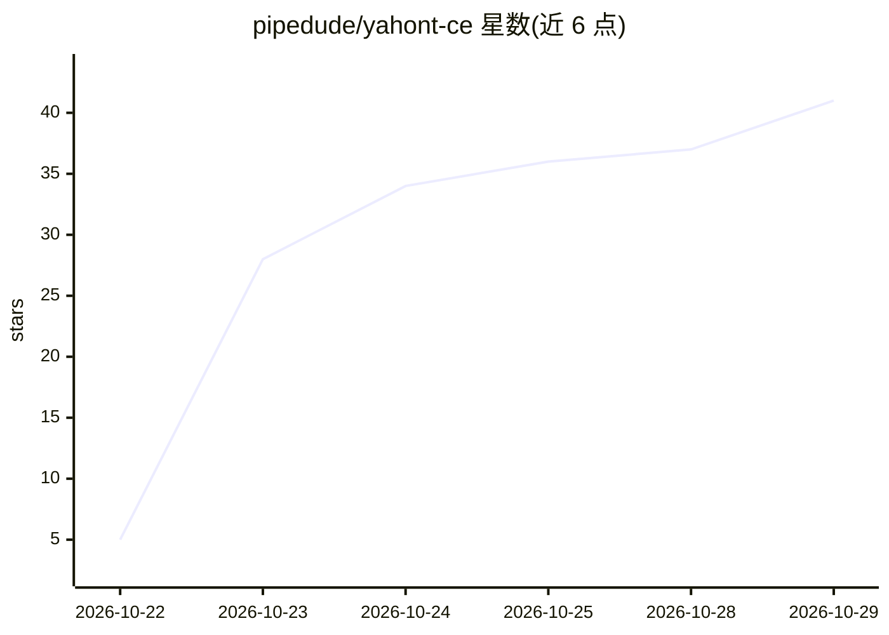

# pipedude/yahont-ce

⭐ 41 · Python · NOASSERTION · 推送 2026-10-28 · [GitHub](https://github.com/pipedude/yahont-ce) · [官网](https://www.yahont.ai) · 组织维护 · 中文 README

**自托管团队知识与上下文层：RAG、代理、多源连接器与任意 LLM**

基于 Onyx (MIT) 二次开发的自托管 AI 平台，面向需要将内部知识接入 LLM 的团队。功能包括 Agentic RAG 混合索引检索、深度研究报告、带知识集与指令的代理、网页搜索、MCP 客户端与服务器、隔离沙箱代码执行、图像生成与语音模式。支持 30+ 知识源连接器（Confluence/Jira/Google Drive/IMAP 等）及俄罗斯本土服务，模型可接 OpenAI/Anthropic/OpenRouter 或经 Ollama/vLLM/LiteLLM/LM Studio 使用自有模型。Docker Compose 部署，分标准（11 容器）与精简（5 容器）两种模式。定位俄语区适配：俄语界面、俄文嵌入模型与俄网关。

## 筛选速览

| 维度 | 判定 | 备注 |
|---|---|---|
| AI 角色 | `ai-native` | 本体是模型或模型工具 |
| 许可风险 | `none` | NOASSERTION |
| 部署形态 | `self-host` | docker 或自建部署 |
| 模型依赖 | local-ok | 支持本地模型 |
| 硬件要求 | — | 无带数字的原话,不猜 |
| 安装摩擦 | `low` | 无编译、无系统依赖或容器化 |
| 成熟度 | `idea` | |

## 能力要点

- Agentic RAG：混合索引（关键词+向量）检索，回答附文档来源链接
- 30+ 知识源连接器（只读），含 Confluence/Jira/Google Drive/S3 及俄罗斯服务
- 作为 MCP 服务器可被 Claude Desktop 等外部代理当作知识源调用
- 标准/精简两种 Docker Compose 部署模式，精简模式基础内存占用低于 1 GB

## 适用场景

- 团队把 Confluence、网盘、邮箱等内部知识统一接入 AI 问答
- 为新员工提供基于规章制度的自助问答与入职支持
- 搭建带知识集和工具指令的客服/销售/IT 支持代理
- 通过 MCP 将企业文档检索能力提供给外部 AI 代理

## 场景标签

`RAG` `AI 助手` `文档问答` · 领域:对话与助手

## 证据(README 行号)

> L43: **Yahont** — слой знаний и контекста для вашей команды и ИИ-агентов.
> L88: - **🔍 Поиск и ответы по документам (Agentic RAG).** Гибридный индекс

## 星数曲线

2026-10-22 5 → 2026-10-29 41（+36）

---
*卡片 v1 · prompt 1.4 · 生成 2026-10-25 · 置信度 high · 依据 README sha `fce4dcc3f2cd` · [字段定义](../../DATASET.md)*
