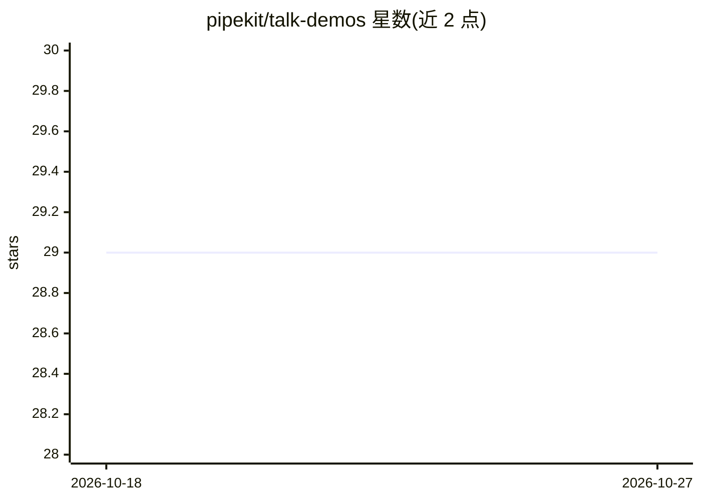

# pipekit/talk-demos

⭐ 29 · Python · AGPL-3.0 · 推送 2026-10-08 · [GitHub](https://github.com/pipekit/talk-demos) · [官网](https://pipekit.io) · 组织维护

**Pipekit 演讲配套代码与文档仓库：Argo/Kubernetes 会议 demo**

由 Pipekit 团队维护的会议演讲配套资源仓库，收录 ArgoCon、KubeCon、Open Source Summit、Observability Summit 等会议演讲的演示代码与文档，主题围绕 Argo Workflows、Argo Events、Argo CD、Kubernetes 上的数据与 CI/CD 流水线、ML 工作流等。仓库同时说明 Pipekit 提供 Argo Workflows 商业支持及其 Argo 控制平面产品。受众为使用 Argo 与 Kubernetes 的平台团队和数据工程师。

## 筛选速览

| 维度 | 判定 | 备注 |
|---|---|---|
| AI 角色 | `ai-knowledge` | 知识聚合/清单类 |
| 许可风险 | `viral` | AGPL-3.0 |
| 部署形态 | `None` |  |
| 模型依赖 | — | README 未给出锁定关系 |
| 硬件要求 | — | 无带数字的原话,不猜 |
| 安装摩擦 | `low` | 无编译、无系统依赖或容器化 |
| 成熟度 | — | 结构信号不足 |

## 能力要点

- 覆盖 2021-2026 年多届 ArgoCon/KubeCon 等会议演讲的 demo 代码与文档
- 主题含 Argo Workflows/Events/CD、Hera、数据与 CI/CD 流水线、LLM 训练工作流
- 附 Pipekit 的 Argo Workflows 商业支持说明

## 适用场景

- 查找某场 Argo/KubeCon 演讲的配套代码与示例
- 学习 Argo Workflows 在数据流水线与 ML 场景的实践用法
- 了解 Pipekit 的 Argo 支持与产品信息

## 场景标签

 · 领域:云原生/工作流编排（会议演示资源）

## 证据(README 行号)

> L3: This repo contains demos from ArgoCon, KubeCon, Open Source Summit, and Observability Summit.
> L66: Pipekit is the control plane for Argo Workflows. Platform teams use Pipekit to manage data & CI pipelines at scale,

## 星数曲线

2026-10-18 29 → 2026-10-27 29（+0）

---
*卡片 v1 · prompt 1.4 · 生成 2026-10-26 · 置信度 mid · 依据 README sha `0855c5300751` · [字段定义](../../DATASET.md)*
